# SPEC-0007: A pedalboard below the sequencer, with a resonator pedal modelled on the Kinotone Ghosts

| Field | Value |
|---|---|
| Spec | SPEC-0007 |
| Revision | r1, draft, 2026-10-18 (rebased on `main` at `f6e3ca0`) |
| Stage | **Planning only.** It is written outside the repository (`/workspace/specs-safe/`). It adds no code, contract, fixture or threshold, and nothing has been pushed |
| Risk tier | **Low** for the spec itself (`specs/`, `journal/`). Every slice is **Medium** (`apps/web/`, Forge). None touches `contracts/`, the engine, the events or the ABI |
| Owner and approver | `@beaudesign` |
| Task | Not allocated yet. Proposed: `WENGE-0036`, the next number after `WENGE-0035`, which SPEC-0006 uses on `main` (#74). WENGE-0032 to WENGE-0035 are all taken on `main` or open pull requests |
| Extends | SPEC-0004: the `Voice` interface, the rig and the renderer from S0, and decision D6 (mono), which this spec changes (D2 below). SPEC-0006 (on `main`, #74): the kit's output feeds the board, and this spec takes over SPEC-0006's slice K8 (pedals) |
| Amends | **SPEC-0004 S7 Complex** (section 9). It adds front-panel controls and patch points. SPEC-0004 itself is not edited here. The amendment is copied in by a later SPEC-0004 revision once the owner approves this spec |
| ADR | **ADR-0015, reserved** (section 2.3). ADR-0014 is the voices ADR on #70 |
| Base | `main` at `f6e3ca0` (r0 was written against `c079f8f`). `specs/SPEC-0006/` and SPEC-0004 S0 are read from `main`. Also read: `handoff/eng-spec-shape-player-complex-v2` at `58c4150` and `conductor/adr-0013-the-sound-is-a-feature` at `81498f2` (#70, open) |

## 1. The ask

Recorded here because chat is not a source of truth. The owner's answers to the modular-kit plan (`/workspace/specs-safe/modular-kit-plan.md`) were relayed on Sat 2026-10-17 at 15:50 London:

> 1. Q1: the SPEC-0004 Complex voice (S7) STAYS as the Verbos Complex Oscillator (not DPO). He wants it to have front-panel controls you can tweak like a real modular: knobs/switches matching the hardware panel (timbre, symmetry, order, FM index, sync, etc. per the Verbos manual), plus patch points/modulation inputs where sensible. Note this as an amendment to S7 in the new spec; don't edit SPEC-0004 itself.
> 2. Ghosts: build it from scratch, closely mimicking the real pedal in software, based on the circuit board and the PDFs. [...] Be honest in the spec that a board shows the analog front end and chips, not the DSP algorithms, so the resonator/Touch algorithms are matched by measurement and listening against the manual's behaviour. Do NOT dump, decompile or reverse-engineer firmware, and copy no third-party code; clean-sheet implementation only.
> 3. Yes: the pedalboard becomes its own new spec, SPEC-0007.

**How this is read.**
- "Closely mimicking the real pedal" means that **every documented behaviour is reproduced and tested**, with the same controls, ranges, modes, menus and MIDI map.
- Behaviour that is not documented is tuned against Ben's own unit by measurement and by ear. The same rule appears in SPEC-0006 (D3, Q-S6-5): only the owner's own recordings are used, never third-party audio.
- "Based on the circuit board" is honoured as far as the public record allows. No photograph of the Ghosts board was found (section 3). What is public about the hardware (the chips, the analog paths, the levels) is used for the input and output stage. The DSP is matched by behaviour, because a board can't show an algorithm.

## 2. Where this sits

### 2.1 What the page has today (read from the code on `main` at `f6e3ca0`, not recalled)

- SPEC-0004 S0 has landed (#73, WENGE-0032). `apps/web/src/voices/voice.ts` defines the `Voice` interface and `SLOT_COUNT = 24`; `plain.ts` is the `Plain` voice, which reproduces the old tone; `registry.ts` holds the voices and `DEFAULT_VOICE`.
- `apps/web/src/monitor.ts` owns the 24 slots, the seeded noise drums and the mix. The pitched sound is a `Voice` from the registry. `VoiceNote.next()` returns one mono sample per note.
- The mix is still **mono**: `out[i] = clamp(out[i] + MASTER * tanh(mix))` (`monitor.ts` about line 212). That `tanh` master is where the board hooks in: voices and drums sum, then the board, then the master stage.
- `apps/web/src/worklet.ts` renders 128-frame blocks, decodes the engine's events with `atSample`, and writes **one channel** (`outputs[0][0]`, about line 105). So D2 (stereo) changes `monitor.ts` and `worklet.ts`.
- The board takes the summed bus, so the `Voice` interface needs no change for the board. It only matters if per-voice panning inside a voice is wanted (the stereo-in voice spread, G-17).
- S0's rig and renderer now exist and the board reuses them: `apps/web/test/support/voice-checks.ts`, `voice-stubs.ts`, `spectrum.ts`, `test/voice-rig.test.ts`, and `apps/web/scripts/render-voices.ts` with `wav.ts`.
- There is no effect, no stereo and no pedal anywhere in the tree.
- SPEC-0004 §9 puts effects and stereo out of scope, and its D6 says mono.

### 2.2 Relationship to the other specs

| Spec | What this spec takes or changes |
|---|---|
| SPEC-0004 (r1 and S0 on `main`, r1.2 on #70) | **Layered on it.** The board receives the summed output of the voices behind S0's `Voice` interface. The board reuses S0's rig (Node tests, seeded determinism, the allocation check, files listed in 2.1) and S0's offline renderer (`apps/web/scripts/render-voices.ts`). **D6 changes** (D2 below). **S7 is amended** (section 9). The rows H-1 (Plain unchanged), H-12 (events byte-identical) and H-16 (registry) stay green throughout |
| SPEC-0006 (on `main`, #74) | The kit's bus is a second input to the board's sum, next to the voices. Its slice **K8 (pedals) moves here**. On `main`, K8 still lists the original designs (Shake, Drive, Sweep, Squeeze, Chorus, Tape, Fold, Shift, Ring, Crush) under D10. **Its decision D10** ("pedals are original designs, not copies of a product") **is overridden for pedal 1 only, by the owner's instruction above.** Every later pedal stays original under D10 unless the owner says otherwise (Q-7-8). D9 (algorithmic reverbs only) is kept |
| The v2 handoff (shape player and S7) | S7's parameters, observables H-17 to H-33 and sub-slices S7a to S7e are kept. Section 9 adds sub-slices S7f and S7g. The handoff's S7 non-goals "CV inputs or a modulation matrix" and "per-parameter UI" are lifted for S7 only, by the owner's answer |
| Numbering | The handoff reserved SPEC-0006 for the shape player, but SPEC-0006 is now the modular kit (on `main`, #74). So the shape player needs a new number, and the conductor resolves this outside this spec (Q-7-9). **SPEC-0007 is free** on `main` and on all 71 remote branches |

### 2.3 The ADR

- **Reserved: ADR-0015.** ADR-0001 to ADR-0012 are on `main`. The open pull request #70 on `conductor/adr-0013-the-sound-is-a-feature` holds `adr/0014-the-pages-sound-is-a-feature-and-its-voices-stay-in-typescript.md`, and `voices/voice.ts` and `monitor.ts` on `main` already cite ADR-0014. No branch holds an ADR-0013, 0015 or 0016 (checked 2026-10-18). So this spec's ADR moves from r0's 0014 to **0015**.
- **Risk of a clash.** The handoff's draft shape-player ADR was numbered 0013 and must move. SPEC-0006's K0 ADR is "numbered when it is written". Whichever of these is written first takes the next free number. If one of them reaches `main` first, this spec's ADR takes the next number after it, and this table is updated.
- **What ADR-0015 records:**
  1. The page gains an **effects chain** (the pedalboard) after the voices and the kit.
  2. **D6 changes**: the page is mono up to the first stereo pedal and stereo after it.
  3. **Pedal 1 deliberately models a named product**: a behavioural model, written clean-sheet, under the provenance rules of section 3.4.

## 3. The Ghosts hardware: what is public, what is inferred, what is unknown

Searched on 2026-10-17:
- Kinotone's product page, paper manual, web manual and image library;
- the Kinotone forum (its public JSON API, every Ghosts-tagged topic, and searches for chip, sample rate, latency, relay, codec and memory terms);
- TI's TAC5242 page and datasheet;
- Elektronauts, Synth Anatomy, Guitar Pedal X, The Pedal Zone and Effects Database;
- YouTube video descriptions (Kinotone's "Introducing Ghosts" and about a dozen third-party demos);
- X (no matching posts), and the FCC ID search.

Reddit returned a block page to scripted reads, so its two r/guitarpedals threads were found but not read. ModWiggler, Gearspace and KVR searches surfaced no Ghosts hardware thread.

**Source keys** (full URLs in section 13):

| Key | Source |
|---|---|
| [KP] | Kinotone product page |
| [GH-P] | Paper manual V1.0 (firmware 1.0) |
| [GH-W] | Web manual, "the source of truth" ([GH-P] p.42) |
| [F-nnnn] | Kinotone forum topic nnnn. Posts are by the designer, Jaak Jensen, unless marked |
| [TI] | TAC5242 datasheet |
| [IMG] | Kinotone's product photographs |

### 3.1 Findings

| Area | Finding | Status | Source |
|---|---|---|---|
| Processor | "DSP: 480Mhz ARM processor", "32-bit floating point" | **Known** (maker) | [KP] |
| Processor part number | Not published. Kinotone's earlier pedal, Ribbons, uses an **STM32H7** ("our DSP chip (STM32H7)"), sourced through Electro-Smith's Daisy Seed supply. 480 MHz is the top clock of that family | **Inferred, unconfirmed for Ghosts** | [F-280], [F-305] |
| Codec | "Ultra-low-noise 32-bit TAC5242 audio codec (119dB dynamic range)" | **Known** (maker) | [KP] |
| Codec capability | TI TAC5242: **2 ADC and 2 DAC channels** (stereo). ADC and DAC sample rates 8 to 192 kHz. 24- or 32-bit words. Pin-selectable linear-phase or low-latency decimation and interpolation filters. ADC DC-removal high-pass at 1 Hz or 12 Hz (at 48 kHz). Mic bias. 2 Vrms differential or 1 Vrms single-ended full scale | **Known** (chip vendor). Which options Ghosts uses is **unknown** | [TI] |
| Sample rate | Not published for Ghosts. Ribbons "runs at 48kHz" | **Unknown.** 48 kHz is a guess from the sibling pedal | [F-166], [F-608] |
| Block size and memory | Not published. Endless Loop holds 20 s at 1× (40 s at 0.5×, 10 s at 2×). That is far more than the processor's internal memory holds, which points to external RAM (Ribbons uses SDRAM for its loops) | **Unknown** (external RAM inferred) | [GH-P] p.24, [F-3786] |
| Latency | "Latency: 1 msec" | **Known** (maker). How it was measured is not stated | [KP] |
| Levels | Maximum input level +12 dBu. Input impedance 1 MΩ. Output impedance 1 kΩ. Frequency response 24 Hz to 20 kHz | **Known** | [KP] |
| Power | +9 V DC, 2.1 mm, centre-negative, 220 mA. Protected up to +14 V and against reverse polarity down to −20 V | **Known** | [KP], [GH-P] p.4 |
| I/O | TRS stereo input and TRS stereo output; TRS MIDI input with Type A/B auto-detection; USB-C (a USB MIDI *device*); CV/EXP jack; 9 V jack. Per [IMG]: input, CV/EXP and power on one side; USB-C, MIDI and output on the other | **Known** | [KP], [GH-W], [IMG] |
| MIDI out | None documented. A user confirms there is none | **Known** (absence) | [F-3669] (user post) |
| Bypass | The manual lists three: **analog bypass** ("uses an analog switch to completely bypass Ghosts' audio converter"; the default), **buffered**, and **buffered with trails**. Mono in / stereo out forces buffered ("we need a buffer to split your signal"). The product page lists only the two buffered modes, at a +18 dBu clipping level | **Known.** The switch part is **unknown**: the manual says "analog switch", not relay. Ribbons used a relay for its bypass | [GH-P] p.40, [GH-W], [KP], [F-1197] |
| Contact mic | A piezo inside the front panel (the gold oval). "The piezo is mixed with the main audio input before it hits the converter ... the piezo has its own gain control path with an analog VCA and analog switch". It is fully disconnected when off or when the pedal is bypassed. The MIC GAIN knob is marked **−110 dB to +10 dB** | **Known** (designer, panel graphic). Preamp topology and parts **unknown** | [F-3449], [F-2919], [GH-W], [F-3474] graphic |
| CV/EXP | 0 to 5 V, mapped to any knob and to the TOUCH switch; 0 V = 0%, 5 V = 100%. "CV control up to 500Hz". "Over/under voltage protection up to ~ +/-18V ... >5V it will clamp at 5V and anything less than 0V will be clamped to 0V". Mapping is global, not per preset | **Known** | [GH-W], [KP], [F-2971] |
| Limiter | "A brick wall output limiter ... always engaged but set to the minimum by default". The knob reads "less limiting" to "more limiting" (the designer: "Fully down is the minimum amount of limiting"). Instrument level lowers its threshold by 10 dB | **Known** behaviour. It runs in DSP (it is a menu-linked parameter and saved in presets). Its threshold in dBFS, attack, release and look-ahead are **unknown** | [GH-P] p.18, [GH-W], [F-3474] |
| Dry/wet | Not stated for Ghosts. Ribbons mixes dry and wet "in software because if we did an analog dry/wet mix it would result in a fixed comb-filter" | **Inferred** (software mix), unconfirmed | [F-778] |
| Board photographs | **None found.** No teardown and no inside photo were published. Kinotone's forum shows built units on trays and its test station ("KATS", which "measures every pot, button, footswitch, LED, and both the MIDI and CV circuits"), not opened boards. A "Clear" colour is listed on the product page with no photograph | **Unknown** | [F-3614], [KP] |
| FCC | No FCC grantee or filing for Kinotone was found. A pedal with no radio would normally be authorised by the supplier's own declaration, which leaves no public FCC filing, so none is expected | **Unknown** (none found) | FCC ID search |
| Firmware | Updated over USB-C | **Known.** It is **out of bounds** for this work (section 3.4) | [GH-P] p.42 |

### 3.2 What the designer has published about the DSP (beyond the manual)

- **Chord voicings** ([F-2921]). Each chord is a six-note list of semitone offsets from the root, including deliberate small detunes. The panel's CHORD notches, in order ([GH-P] p.6), are oct, 5, 4, m, m7, m9, m11, 69, M9, M7, M and user: 11 chords plus the user notch, which makes the "12 preset chords".

  | Notch | Offsets (semitones) |
  |---|---|
  | oct | 0.00, 0.02, 0.01, 11.99, 12.00, 12.01 |
  | 5 | 0.00, 0.01, 7.00, 7.01, 14.00, 21.00 |
  | 4 (sus4) | 0.00, 2.00, 5.00, 5.01, 10.00, 12.00 |
  | m | 0.00, 3.00, 7.00, 7.01, 12.00, 15.00 |
  | m7 | 0.00, 3.00, 7.00, 10.00, 12.00, 12.01 |
  | m9 | 0.00, 3.00, 7.00, 10.00, 12.00, 14.00 |
  | m11 | 0.00, 3.00, 7.00, 10.00, 14.00, 17.00 |
  | 69 | 0.00, 4.00, 7.00, 9.00, 12.00, 14.00 |
  | M9 | 0.00, 4.00, 7.00, 11.00, 12.00, 14.00 |
  | M7 | 0.00, 4.00, 7.00, 11.00, 12.00, 16.00 |
  | M | 0.00, 4.00, 4.01, 7.00, 12.00, 12.01 |

- **VOICING** "behaves like an inversion sweep. As you turn it clockwise, the lowest note(s) in the stack get raised by an octave, one at a time, and the transitions are smoothed" ([F-2921]). A user also hears "a glide to the next pitches" ([F-3874]). The number of steps across the knob is not stated.
- **What the model is:** "a bunch of tuned, resonant filters; it's not a pitch tracking synth effect" ([F-3823]). "Decay is literally the amount of resonance."
- **Tubes and Bars:** "based on modal resonators ... the upper partials are often 'stretched'". At high TONE the upper partials dominate and the sound can read as sharp, while the fundamental is "spot on" ([F-3743]).
- **Factory preset tunings** (corrected by the designer in [F-3329]):
  1. INIT: equal temperament, "Herbie Hancock minor 9 voicing".
  2. DARK SHIFTER: Hyperconcord.
  3. STRING LOOPS: 29th Harmonic Rainbow.
  4. GLITTER PHYSICS: 7-limit JI.
  5. HARMONIC PULSE: a 13 EDO subset.
  6. SPARKLE SHIFTER: a 666 EDO subset.

  Chords 2 to 6 were "discovered by ear" and are not given.
- **Velocity:** a user reports that velocity is "already in the coding" but not enabled. **Unverified.** The model ignores velocity unless the owner asks (Q-7-6).

### 3.3 What a board can and can't tell us (stated plainly)

- **A board can show** the analog front end: input buffer, impedance, the piezo preamp and VCA, the bypass switch, the output driver and the clipping levels. It can also show which chips are fitted (processor, codec, memory) and which codec filter and sample-rate pins are strapped. Even that is unavailable for Ghosts, because no board photograph is public.
- **A board can't show** any DSP: the resonator models, mode tables, reverb, granular engine, looper, drum voices, frequency shifter, limiter law or MIX law. Those live in firmware, and reading the firmware is ruled out.
- **So:**
  - The **front end** is modelled from published numbers (levels, ranges, the mic gain span, the CV clamp, bypass behaviour).
  - The **DSP** is a clean-sheet design that reproduces the manual's documented behaviour and the designer's published tables. It is then fitted to Ben's unit by measurement (section 6) and accepted by Ben's ear.
- Anything still unmatched is labelled "stand-in" in code and in this spec.

### 3.4 Provenance rules (clean-sheet)

1. **No firmware access of any kind.** No dumping, decompiling, disassembling, binary diffing, or reading update files. No probing the USB-C port beyond sending documented MIDI, SysEx (MTS) and Program Change.
2. **No third-party code.** Mutable Instruments (Rings, Elements), benny, Daisy/DaisySP and any other implementation are not copied or ported. Papers and textbooks are the only DSP sources (section 13).
3. **Allowed:** the manuals, the product page, the designer's public forum posts, TI's datasheet, public papers, and black-box measurement of Ben's own unit through its jacks.
4. **Recordings:** only Ben's own unit, recorded by Ben or for Ben. No third-party demo audio is used as a reference (as SPEC-0006 Q-S6-5).
5. **Names:** the page shows plain names (D5 of SPEC-0004, D2 of SPEC-0006). "Kinotone" and "Ghosts" appear only in specs, the ADR and code comments, as the reference behaviour, and imply no affiliation.
6. Every constant carries a `Ref:` line saying where it came from: `[GH-P] p.N`, `[F-nnnn]`, `fit: <take id>`, or `stand-in`.

## 4. The pedalboard

### 4.1 Where it is

- **On the page.** A **pedalboard strip directly below the sequencer**, full width.
  - Each pedal is a card drawn as its enclosure: knobs, LEDs, buttons and footswitches, laid out as the real panel (section 5.10).
  - A `+` slot at the end adds a pedal.
  - Pedals are dragged to reorder.
  - Tapping a footswitch bypasses; holding TOUCH is momentary, as on the pedal.
  - On a phone the strip scrolls sideways, and a tapped pedal opens full width.
  - The design system holds: no new colour; LEDs are the only saturated colour (`CLAUDE.md` rules 5 and 6; ADR-0010 and ADR-0011).
- **In the audio.** The board runs **inside the same AudioWorkletProcessor**, after the voices and the kit, in the same 128-frame block. It adds no thread and no extra block of latency. The offline renderer runs the same code in Node.

```
engine events ─► voices (SPEC-0004, behind Voice) ─┐
              └► kit rack (SPEC-0006)  ────────────┴─► SUM (mono) ─► pedal 1 ─► pedal 2 ─► … ─► output stage ─► destination / renderer
     engine MIDI (notes, CC, PC, clock, start/stop) ─► pedals that subscribe        metronome ─► mixed after the board (D7)
```

### 4.2 The pedal interface

```ts
type Ch = 1 | 2;
interface PedalDef {
  type: string;                      // e.g. "resonator"; plain name (D5)
  lineage: string;                   // spec/comment only, e.g. "Kinotone Ghosts fw 1.0"
  params: ParamDef[];                // panel units; layer: "black" | "white" | "hidden" | "menu"
  io(state: PedalState): { in: Ch; out: Ch };       // may depend on a menu (Ghosts: §5.9)
  latencySamples(sampleRate: number): number;       // fixed for a given state; reported to the board
  tailSeconds(state: PedalState): number | "infinite";
  midi?: { notes?: boolean; cc?: Record<number, string>; pc?: boolean; clock?: boolean; sysex?: "mts"[] };
  create(sampleRate: number, seed: bigint): PedalInstance;
}
interface PedalInstance {
  process(inL: Float32Array, inR: Float32Array, outL: Float32Array, outR: Float32Array, from: number, to: number): void;
  midi(atSample: number, bytes: Uint8Array): void;  // sample-accurate, from the engine or the page
  cv(atSample: number, volts: number): void;        // the CV/EXP jack, fed from a kit cable (SPEC-0006) or a page control
  setParam(id: string, v: number): void;            // smoothed per ParamDef.smoothingMs
  footswitch(id: "bypass" | "touch" | string, down: boolean, atSample: number): void;
  getState(): PedalState; setState(s: PedalState): void;
  reset(): void;
}
```

- **Bypass modes** (per instance; Ghosts' three modes are the model):
  - `hard`: the input is copied to the output and the pedal stops processing. Its tail is cut. This is the "analog bypass" of [GH-P] p.40.
  - `buffered`: the same, switched with a crossfade. The default length is 5 ms, a stand-in; Ribbons fades wet out and dry in "depending on how the mix knob is set" [F-1197].
  - `trails`: the dry input passes, and the pedal keeps running with its **input muted**, so resonators, reverb, loops and drums carry on (the manual's "buffered bypass with trails").
  - A pedal may force a mode in a given state (Ghosts forces `buffered` in mono in / stereo out).
- **Wet/dry.** A pedal that has its own MIX (Ghosts) owns it. For other pedals the board offers a generic equal-power `blend`, off by default. The board never adds a second mix on top of a pedal's own.
- **Presets.**
  - *Pedal presets* are `PedalState` JSON: every parameter on every layer, the modes, user tables such as the user chord and MTS scale, and for Ghosts the 32 slots of section 5.8.
  - *Board presets* hold the order, each pedal's bypass state and each pedal's live state.
  - Both are stored as files beside SPEC-0006's patches (patch storage is a file there too).
  - Program Change addresses a pedal's own slots, as the pedal does.
- **Order.** A series chain in v1. A reorder is applied at a block boundary with a 10 ms crossfade between the old chain's output and the new one's. Parallel lanes and send/return are not done (section 12).
- **Mono and stereo (D2).**
  - Everything up to and including the sum is mono, as D6 says today.
  - The board stays mono until the first pedal whose output is stereo. From there to the output it is stereo, and a mono pedal after that point processes L+R and writes both channels.
  - With no stereo pedal, the page is exactly as mono as today.
  - The worklet's output channel count follows the board. The renderer writes the same count and records it next to the WAV.
- **Latency.**
  - Each pedal reports `latencySamples`, and the board shows the sum.
  - **Budget: 64 samples in total** (1.33 ms at 48 kHz). A pedal design that needs look-ahead beyond that is refused.
  - The live page can't move audio earlier, so the budget keeps the board tight to the grid.
  - The **offline renderer compensates**: it trims the reported total from the start of the render and pads the end. A rendered file therefore lines up with the grid and the click to the sample (PB-6).
- **Determinism.** All randomness is seeded from the page seed and the pedal's slot. There is no allocation after `create` (S0's text check), and every output is finite and bounded (the H-6-style sweep).
- **Output stage.** After the board: a final safety limiter at −0.3 dBFS (peak, no look-ahead), then the destination. It replaces `monitor.ts`'s `tanh` only for the board's output path; with an empty board, the H-1 path is unchanged.

## 5. Pedal 1: the resonator (Kinotone Ghosts model)

Plain name on the page: **Resonator** (D5). Reference: Ghosts firmware 1.0, per [GH-P] and [GH-W].

### 5.1 Controls (one panel, three layers)

Six knobs in two rows of three. The LAYER button switches the black and white layers; Hold LAYER + tap MIC opens the hidden layer ([GH-P] pp.6, 17; [F-3474] graphic; [IMG]).

| Position | Black layer (green LEDs) | White layer (white LEDs) | Hidden layer (pink LEDs) |
|---|---|---|---|
| Top left | TONE | REVERB (with its own ring: pre on the left, post on the right) | INPUT FILTER (low cut ↔ high cut) |
| Top centre | ROOT | POSITION | LIMITER THRESHOLD (less ↔ more limiting) |
| Top right | MIX | TOUCH 1 | TOUCH PRE/POST |
| Bottom left | DECAY | TIME | EXCITER (Pluck/Strike, Air with attack rising, Vocoder, Vocoder Hold) |
| Bottom centre | CHORD (12 marked notches) | VOICING | MIC GAIN (−110 dB to +10 dB) |
| Bottom right | VOLUME | TOUCH 2 | TOUCH 3 |

- **Buttons:** MODEL, MIC, LAYER.
- **Footswitches:** TOUCH (left), BYPASS (right). The contact-mic pad sits between the buttons and the footswitches.
- **Relative knobs** ([GH-P] p.7). After a layer change, a knob whose position doesn't match the stored value moves the value "based on the amount of space available" until the two meet, so the value never jumps. On the page, each knob is drawn at its stored value per layer. The relative behaviour applies only to a hardware MIDI controller mapped to the page (Q-7-7).
- **State save.** The pedal saves 3 s after LAYER, MIC, MODEL or BYPASS is pressed. The page saves its board state the same way; the 3 s delay is kept so that a reload behaves the same.

### 5.2 Block diagram

The order of the stages follows the manual. Arrows marked *(inferred)* are not stated anywhere and are tuned or asked about (Q-7-3).

```mermaid
flowchart LR
  IN["Input L/R<br/>(mono/stereo, inst/line)"] --> BYP{"Bypass<br/>hard / buffered / trails"}
  MIC["Contact-mic stand-in<br/>(aux exciter, MIC GAIN -110..+10 dB, MIC on/off)"] --> SUMIN
  BYP -->|engaged| SUMIN(("analog-domain sum<br/>[F-3449]"))
  SUMIN --> IF["INPUT FILTER<br/>HP 0-63 / LP 64-127"]
  IF --> GATE["MIDI Takeover input gate<br/>(per voice in Vocoder modes)"]
  EXC["Internal exciter<br/>Pluck/Strike or Air"] --> XS
  GATE --> TPRE{"Touch PRE?"}
  TPRE -->|pre| TM1["Touch Mode<br/>Terrazzo / Endless Loop / Rhythm / Shepard"] --> RVPRE
  TPRE -->|post| RVPRE{"REVERB 0-63:<br/>pre"}
  RVPRE -->|pre amount| RV1["Reverb (TIME)"] --> TLP
  RVPRE --> TLP["TONE: input low-pass"]
  TLP --> XS(("exciter sum"))
  XS --> RES["6 resonators<br/>Strings / Tubes / Bars<br/>DECAY, TONE HF decay, POSITION<br/>tuned by CHORD+ROOT+VOICING or MIDI"]
  RES --> VOL["VOLUME (wet level)"]
  VOL --> TPOST{"Touch POST?"}
  TPOST -->|post| TM2["Touch Mode"] --> RVPOST
  TPOST --> RVPOST{"REVERB 64-127:<br/>post"}
  RVPOST -->|post amount| RV2["Reverb (TIME)"] --> MIX
  RVPOST --> MIX["MIX dry ↔ wet<br/>(dry tap point inferred)"]
  SUMIN -. "dry (inferred)" .-> MIX
  MIX --> LIM["Brick-wall limiter<br/>(LIMITER, -10 dB at inst level)"]
  LIM --> OUT["Output L/R"]
```



Notes on the diagram:
- **The single reverb.** It is one reverb, placed either before or after the resonators (REVERB's two halves). It is drawn twice only to show the two positions; it is never in both.
- **Touch Modes after the resonators.** With the internal exciter on, Touch Modes "are automatically shifted to the output" ([GH-P] p.28).
- **The Rhythm Generator** is a *source*. Pre, it is summed with the input; post, it is summed after the resonators ([GH-P] p.29). "Touch Mode" in the diagram means "process or add".
- **TONE** acts in two places at once: the input low-pass and the resonators' high-frequency decay ([GH-P] p.14).
- **The contact mic.** On the hardware it is summed into the input before the converter. Its software stand-in (D9) enters at the same point.

### 5.3 Input stage, levels and limiter

| Item | Manual or maker behaviour | Model (clean-sheet) | Constant status |
|---|---|---|---|
| Input level | Maximum +12 dBu; 1 MΩ input ([KP]). Instrument or line level by menu ([GH-P] p.39) | The page has no analog level. The board's signal is full-scale float. "Instrument" and "line" keep their *documented* differences only (below) | Known |
| Instrument level | "lowers the limiter threshold by 10 dB, limits the contact mic volume, and softens the levels of the drum machine and internal exciter" | Limiter threshold −10 dB (exact). Mic gain ceiling, drum level and exciter level each reduced by a constant | −10 dB known; the other three amounts **fit** |
| INPUT FILTER | "An input low-cut or high-cut filter" (left low cut, right high cut). CC 30: 0–63 high-pass, 64–127 low-pass | One 2-pole TPT state-variable filter. Left of noon: high-pass, with the cutoff rising from 20 Hz (flat) as the knob turns left. Right of noon: low-pass, with the cutoff falling from 20 kHz. Noon is flat (filter bypassed) | Shape and corner law **fit**; endpoints are a stand-in |
| Contact mic | Piezo summed with the input before the converter; analog VCA and switch; gain −110 to +10 dB | **Stand-in input** (D9): a selectable source summed at the input, with gain −110 to +10 dB (exact span) and an on/off switch (MIC). Fully silent when off or bypassed (exact) | Span known |
| Limiter | Brick wall, always on, minimum by default; the knob goes from less to more limiting | A peak limiter with **no look-ahead** (latency budget): instant attack via a gain computer on the absolute sample, a program-dependent release, and a final soft clip at the ceiling. The knob lowers the threshold from 0 dBFS to a fitted floor | Threshold law, floor and release **fit**; no look-ahead is a decision (D4) |
| Analog sum and dry tap | Manual: the mic is mixed "in the analog domain" | The dry signal for MIX is taken after the mic sum and before the INPUT FILTER (inferred: the manual says that at low MIX "you'll hear more of the raw contact mic sound") | **Inferred** (Q-7-3) |

### 5.4 Exciters and input gating

- **MIDI Takeover** ([GH-P] pp.33–34).
  - Any MIDI note enters Takeover. While in it:
    - input and mic are **muted unless a note is held**;
    - CHORD, ROOT and VOICING are ignored, and the notes set the tuning.
  - Turning ROOT exits Takeover. Model: on any ROOT change greater than one CC step, or any ROOT parameter event from the page.
- **Exciter regions** (CC 31: 0–31 Pluck/Strike, 32–63 Air, 64–95 Vocoder, 96–127 Vocoder Hold).
  - **Pluck/Strike** (internal exciter on). A note retunes a voice and excites it: Strings are plucked, Tubes and Bars are struck. Model: a short band-limited burst (seeded noise through a one-pole low-pass at the TONE cutoff, 1–5 ms Hann window, stand-in) for Strings, and a raised-cosine mallet pulse (stand-in width) for Tubes and Bars.
  - **Air** (internal exciter on). "A breath-like excitation"; within the Air region, turning further increases the attack time. Model: seeded noise through a band-pass at the voice's pitch, with an AR envelope whose attack is mapped from the knob's position inside 32–63 (range is a stand-in, then fit) and which sustains while the note is held. A user calls it "a little inflexible" [F-3692], so no extra controls are added.
  - **Vocoder** (internal exciter off). A note retunes a voice and opens its gate to the input; on release the gate closes and the resonator decays naturally. Model: a per-voice gate on the exciter feed (2 ms ramps), with voice allocation that takes the oldest note.
  - **Vocoder Hold.** Notes stay after release until new notes are played. "When a seventh note is played, the oldest note is replaced by the newest. If you release all notes and then play a chord, Ghosts clears the previous stack and holds only the new notes" ([GH-P] p.37). Modelled exactly as a logic table (G-12).
- **Velocity** is ignored (section 3.2; Q-7-6).

### 5.5 Resonators (6 voices) and TONE, DECAY, POSITION

| Model | Manual | Clean-sheet DSP |
|---|---|---|
| **Strings** (MODEL green; CC 33: 0–42) | "Based on the Extended Karplus-Strong algorithm ... adding damping, and the ability to adjust the excitation position". Harmonic | Per voice, an extended Karplus-Strong loop (Jaffe and Smith 1983): a delay line with a Thiran allpass for fractional tuning; a loop low-pass whose cutoff follows **TONE** (the high-frequency decay); a loop gain set from **DECAY**; and a pick-position comb `1 − z^(−⌊βN⌋)` on the *excitation* set by **POSITION** (β from 0.5 down to a small value). A DC blocker sits in the loop. The external input excites the loop through the comb, so the input is shaped by POSITION exactly as a pick or strike would be |
| **Tubes** (blue; 43–85) | "a bank of 18 virtual-analog band-pass filters per voice (that's 108 band-pass filters in total!)". Inharmonic. Partials "stretched" [F-3743] | Per voice, **18 parallel two-pole band-pass filters** (TPT/ZDF state-variable, the "virtual-analog" form). Mode frequencies are `f0 · r_k`. The **r_k table is fitted** to Ben's unit (G-6), starting from an open-pipe-like stretched series `r_k = k · (1 + s·k²)`, with the stretch s fitted. Per-mode decay comes from DECAY, scaled by a TONE-dependent high-frequency factor. Per-mode gain is `|sin(π k x)|` at the strike point x from POSITION |
| **Bars** (pink; 86–127) | Modal. Overtones "more widely spaced and detuned ... brighter" | The same 18-filter bank. Start: the free-free bar ratios (Fletcher and Rossing: 1, 2.756, 5.404, 8.933, 13.34, …, beyond the fifth by `(2k+1)²/9`), plus a small fitted detune per mode. **Fitted** to the unit (G-6) |

- **TONE** "simultaneously adjusts a low-pass filter on your input audio, and the high-frequency decay of the physical models. The resonators are brightest at fully clockwise." Model: one parameter drives (a) a one-pole input low-pass (20 kHz at full clockwise down to a fitted minimum) and (b) the loop filter cutoff (Strings) or the high-frequency decay tilt (Tubes, Bars). Both laws are **fit**.
- **DECAY** sets "the decay time of the resonators. At max decay, they sustain infinitely. Setting DECAY to zero bypasses the resonators." Model:
  - The knob maps to a decay time from a fitted minimum to a fitted maximum, then to **infinite** in the last notch: loop gain exactly 1, and modal poles on the unit circle with energy normalisation and a soft clip so the output stays bounded (G-3).
  - **DECAY = 0 removes the resonators from the path**, leaving the reverb and Touch Modes (exact, G-3).
- **POSITION** "sets the physical excitation point along the resonators. This adjusts which harmonic overtones are emphasized." It is model-dependent: a comb on the excitation for Strings, a mode-shape gain for Tubes and Bars (above). Its endpoints are **fit**.
- **Voice spread in stereo.** Not documented for the resonators. A user reports that "panning of input sounds affects the different parts of a chord" [F-3692]. Stand-in: in stereo-in mode, voices 1, 3 and 5 take the left input and voices 2, 4 and 6 take the right, and the voices are panned alternately left and right at the output. To be confirmed by measurement (G-17).
- **Cost.** 6 × 18 = 108 band-pass filters per sample, at about 10 operations each, is about 1.1 k operations per sample. That fits a worklet block (measured by PB-8).

### 5.6 Tuning: CHORD, ROOT, VOICING, MIDI notes, the user chord and MTS

- **ROOT** is the chord root, "quantized to semitones. Middle C is at 12 noon, and you can pitch shift +/- an octave from there". Model: 25 steps, C3 to C5, with C4 (MIDI 60, 261.63 Hz in 12-TET) at noon.
- **CHORD** has 12 notches: the 11 tables of section 3.2 ([F-2921], exact) plus **user**. The LED blinks on a change ([GH-W]). Moving between chords glides the pitches (stand-in glide time; the manual says retuning is "real-time").
- **VOICING** is an inversion sweep: turning clockwise raises the lowest note(s) by an octave, one at a time, with smoothed transitions ([F-2921]).
  - Model: let N be the number of steps across the knob. Step n raises the n lowest voices of the sorted stack by 12 semitones and re-sorts. Each step glides with a one-pole of a stand-in time constant.
  - N is **unknown**. Default N = 12 (two full inversion cycles of six voices), to be counted on the unit (G-7).
  - "Inverts and transposes", so at the top of the knob the whole stack has moved up an octave or more.
- **MIDI notes** (Takeover): a note retunes one voice to the note's pitch in the active tuning; the oldest voice is taken.
- **User chord** ([GH-W]): with CHORD on user and EXCITER on Vocoder Hold, the held notes (up to 6) become the user chord; it is saved with the state and in presets.
- **User scale (MTS)** ([GH-W], [F-3329]).
  - Ghosts accepts an **MTS Bulk Tuning Dump** SysEx (a public MIDI standard: 128 entries of semitone plus a 14-bit fraction). The preset index in the file is ignored. The scale is active while CHORD is on user. It is saved in presets.
  - Model: a parser for the standard format (written from the MIDI Tuning Standard text, not from any library), a 128-entry frequency table, and a visual confirmation that it was received, as on the pedal.
  - The page also accepts the same file by upload.
- **Factory tunings.** The six factory presets' scales (section 3.2) can only be reproduced if Ben exports them from his unit's behaviour (measured voice pitches) or rebuilds them in Scale Workshop from the named sources. Until then the factory slots carry 12-TET and are labelled stand-in (Q-7-4).

### 5.7 Reverb (REVERB, TIME)

- **Manual.** "Controls the reverb mix + placement" (CC 24: 0–63 pre-resonator mix, 64–127 post-resonator mix). TIME "controls the decay time of the reverb. At max decay, it sustains infinitely". "Stereo reverb", "custom-designed" ([KP], Synth Anatomy). Pre "smears the input, creating a soft, cloudy drone that stirs the resonators"; post "provides greater spatial definition".
- **The algorithm is not published.** Model: a **stereo 8-line feedback delay network** (Jot and Chaigne 1991; Hadamard matrix; mutually prime delays from 20 to 120 ms at 48 kHz, scaled by rate):
  - each line has a one-pole damping filter, and the loop gain is set from TIME as a decay time;
  - **infinite** at maximum (gain 1, with a slow energy normaliser so it stays bounded);
  - gentle delay modulation (a stand-in).
- **The REVERB knob** is two half-ranges. Below noon, the pre-resonator send rises as the knob moves *away from noon* towards the left end. Above noon, the post send rises towards the right end. At noon the send is zero. This reading of "0–63 pre mix" is **inferred**: whether the amount grows towards the left end or towards noon is checked on the unit (G-8).
- **Fidelity.** Decay time against TIME, spectral tilt of the tail, and stereo width are fitted to the unit (G-8). The reverb's character is a stand-in until Ben accepts it by ear.

### 5.8 Touch Modes (TOUCH 1, TOUCH 2, TOUCH 3, TOUCH PRE/POST, TOUCH footswitch)

**Common to all four** ([GH-P] pp.17–29):
- Each mode can go pre or post (CC 26: 0–63 pre, the default) and syncs to MIDI clock.
- The footswitch latches on a quick tap and is momentary when held.
- Hold LAYER + tap TOUCH selects the mode; the LED colour shows it (green Terrazzo, red Endless Loop, blue Rhythm, pink Shepard).
- CC 32 order: 0–31 Endless Loop, 32–63 Rhythm, 64–95 Shepard, 96–127 Terrazzo.
- TOUCH 3 (hidden): Terrazzo dry/wet, Endless Loop loop volume, Rhythm drum volume, Shepard dry/wet.
- With the internal exciter on, the mode is moved post.
- **Clock source on the page:** the engine's clock (ADR-0009), passed as MIDI clock bytes to the pedal (CC 51 and 52 can make it ignore clock or transport).

| Mode | Manual (exact) | Clean-sheet DSP | Unknown, so fit or stand-in |
|---|---|---|---|
| **Terrazzo** | "streaming granular processor ... 6 read heads spread across the stereo field — some play forward, or reversed, some at normal speed, some an octave up". T1 grain size and shape: left of noon plucky, right smooth, **100 ms to 3 s**. T2 grain trigger rate (a clock; faster clockwise). Grains shorter than the clock give tremolo; longer ones fire on different edges. Pre = the grains excite the resonators; post = the resonator tone is shattered | A ring buffer of 6 s (stereo). Six heads; each grain has a start offset, direction (±1), speed (1 or 2) and pan. The envelope is a percussive exponential (left side) or Hann (right side), with size mapped from T1's distance from noon to 100 ms–3 s. The trigger clock comes from T2 (free) or a clock division (synced). Heads are triggered round-robin. Seeded jitter | Which heads are reversed or ×2, pan positions, T2's rate range and divisions, and the envelope curves. Stand-in: heads 1–6 = (fwd 1×, rev 1×, fwd 2×, rev 2×, fwd 1×, rev 1×), panned −1, +1, −0.6, +0.6, −0.2, +0.2 |
| **Endless Loop** | Varispeed looper, infinite overdub. Tap or hold to record; the first pass sets the length; then overdub ↔ play; a double tap stops and erases. T1 direction (both ways, like tape). T2 speed 0.5× to 2×, continuous; **40/20/10 s** maximum at 0.5/1/2×. Synced: lengths quantise to the grid, recording past the maximum switches to overdub, speed has **3 options (0.5×, 1×, 2×)**, and speed and direction change at the loop wrap. CC 60 clears; CC 80 = 127 advances the state (rec, dub, play, dub, play…) | A stereo buffer of 20 s at the page rate, addressed at 1×. Varispeed reading and writing with cubic Hermite interpolation; at speed v the usable length is 20/v s (the documented limits follow directly). Overdub = read + input. The record/overdub/play state machine is exactly as [GH-P] p.23 and [GH-W]. Synced mode snaps the length to whole beats of the engine clock and applies speed and direction at the wrap | The T1 law (a stand-in: a switch at noon, left reverse and right forward), overdub feedback (stand-in 1.0, i.e. "infinite overdubs"), and the time-stretch on tempo change (not modelled; the manual advises against tempo changes, so the model re-pitches) |
| **Rhythm Generator** | "virtual-analog model of a legendary 1981 drum machine with punchy analog resonator circuits ... Kick, snare, hi-hat. Real-time synthesis (no samples)." T1: **11 curated patterns + a 12th Euclidean random** notch (a new pattern each time it is selected). T2: tempo. Pre: mixed with the input, so the drums excite the resonators. Post: clean drums after the resonators. Follows MIDI Start and Stop [F-3669] | Three clean-sheet voices: kick and snare as decaying resonant two-pole filters struck by a pulse (with a pitch envelope on the kick and a noise layer on the snare); hi-hat as noise through a band-pass and high-pass with a short decay. A 16-step sequencer at T2's tempo, or locked to the engine clock. Notch 12 is a Euclidean generator (Bjorklund) seeded freshly each time the notch is entered | The machine is **not named**, and this spec doesn't guess. The 11 patterns are **unknown**; stand-in patterns are labelled as such until Ben transcribes them from his unit (Q-7-5). The tempo range is fitted |
| **Shepard Shifter** | "virtual-analog **Bode frequency shifter** — designed to move deliberately slowly like a phaser or flanger", giving endlessly rising or falling peaks. T1 intensity. T2 direction and rate: left of noon descending, right ascending, accelerating further from noon. Pre affects only the input; post lingers on the decaying resonators | A frequency shifter built from a polyphase IIR Hilbert pair (two 4-section allpass chains) and a quadrature oscillator at a slow shift frequency f_s. Signed f_s from T2 (0 at noon). Output = the shifted signal mixed with feedback through a short delay (2–10 ms, stand-in); this recirculation produces the barber-pole peaks. T1 sets the feedback amount and depth | The f_s range ("deliberately slowly"; stand-in ±0.05 to ±5 Hz), the feedback delay, and T1's law. Fitted by measuring peak motion (G-11) |

### 5.9 MIDI, CV, presets and global menus

- **MIDI channel.** Default 1. [GH-W] says "12 available MIDI channels" but lists LED colours for channels 1–15, which is inconsistent. The model accepts 1–16, and the panel offers 1–15 (Q-7-10).
- **CC map** (exact, [GH-W]):

| CC | Destination | Range |
|---|---|---|
| 14 | Mix | 0–127 |
| 15 | Volume | 0–127 |
| 16 | Root | 0–127 |
| 17 | Chord | 0–127 |
| 18 | Tone | 0–127 |
| 19 | Decay | 0–127 |
| 20 | Touch 1 | 0–127 |
| 21 | Touch 2 | 0–127 |
| 22 | Position | 0–127 |
| 23 | Voicing | 0–127 |
| 24 | Reverb mix and placement | 0–63 pre mix; 64–127 post mix |
| 25 | Time (reverb decay) | 0–127 |
| 26 | Touch pre/post | 0–63 pre; 64–127 post |
| 27 | Touch 3 | 0–127 |
| 28 | Limiter threshold | 0–127 |
| 29 | Mic level | 0–127 |
| 30 | Input filter | 0–63 high-pass; 64–127 low-pass |
| 31 | Exciter type | 0–31 Pluck/Strike; 32–63 Air; 64–95 Vocoder; 96–127 Vocoder Hold |
| 32 | Touch mode | 0–31 Endless Loop; 32–63 Rhythm; 64–95 Shepard; 96–127 Terrazzo |
| 33 | Model | 0–42 Strings; 43–85 Tubes; 86–127 Bars |
| 34 | Mic on/off | 0–64 off; 65–127 on |
| 51 | Ignore MIDI clock | 0 ignore; 1–127 listen |
| 52 | Ignore MIDI transport | 0 ignore; 1–127 listen |
| 60 | Clear Endless Loop | 0–64 false; 65–127 true |
| 80 | Touch footswitch | Endless Loop: 127 advances the state. Other modes: 0–64 off, 65–127 on |
| 81 | Bypass footswitch | 0–64 off; 65–127 on |

- **Program Change.** PC 1–32 loads a slot; PC 0 or above 32 loads nothing. Slots 7–32 start uninitialised. In the Presets Bank, a PC saves to slots 7–32.
- **Presets.**
  - On the pedal: hold LAYER for 3 s for the bank; tap TOUCH to load; tap BYPASS twice to save; INIT can't be overwritten.
  - Saved in a preset: "black and white controls, hidden layer controls, mic and model settings, selected Touch Mode, user chord and scale". Not saved: the bypass state (it persists across preset changes) and the Touch on/off state (reset to off when a preset loads). Both are from a user report in [F-3436]. CV mapping is also not saved (global [F-2971]).
  - The 6 factory slots are INIT, DARK SHIFTER, STRING LOOPS, GLITTER PHYSICS, HARMONIC PULSE and SPARKLE SHIFTER, with Touch Modes per [GH-P] p.30. Their knob values aren't published, so Ben's unit is the source (Q-7-4).
- **CV/EXP.** Mapped to any knob on the black or white layer, and to TOUCH. 0–5 V is 0–100%. Inputs are clamped to 0–5 V. The update rate is limited to 500 Hz ("CV control up to 500Hz", modelled as a 500 Hz one-pole on the CV). A mapped knob is taken over by the jack. On the page, the jack is fed by a SPEC-0006 kit cable or a page slider.
- **Global menus** (a page settings sheet that mirrors the power-up menus):
  - **I/O:** stereo/stereo, mono/stereo or mono/mono, each at instrument or line level (default mono/mono, instrument).
  - **Bypass:** hard, buffered or trails (default hard). Mono/stereo forces buffered.
  - **Factory reset.**
  - These settings are global and persist.

### 5.10 The panel on the page

- **Layout.** The card is drawn as the pedal's top face, in proportion (12.1 × 6.6 cm footprint, [KP]):
  - two rows of three knobs, each with its LED;
  - MODEL, MIC and LAYER buttons with their LEDs;
  - a pad standing in for the contact mic: tap it to fire a short excitation burst into the input, which is the page's stand-in for "strum the oval" (D9);
  - TOUCH and BYPASS footswitches with their LEDs.
- **Knob labels.** Each knob shows both printed labels (black and white layer) as the pedal does. The active layer is lit; the LAYER LED is lit on the white layer.
- **Hidden layer.** Long-press LAYER, or LAYER + MIC with two fingers, relabels the knobs with the hidden layer's legends and turns the LEDs pink.
- **LEDs:**
  - brightness follows the value (a gradient per layer: green for black, white for white, pink for hidden);
  - the MODEL LED shows the model colour (green, blue, pink);
  - the TOUCH LED shows the mode colour and, for the looper, its state (solid red recording, glowing red overdubbing, blue playing with brightness ramping over the loop);
  - the CHORD and ROOT LEDs blink on a change.
- **Colour.** The only saturated colours are LEDs (`CLAUDE.md` rule 6). The enclosure is drawn in the design system's neutrals, not the pedal's green (Q-7-2).
- **Menus.** The global menus are a settings sheet behind a small gear on the card, not power-up gestures. Their states are the same six I/O choices and three bypass choices.
- **Accessibility.** Every control has a label and keyboard steps (CC-sized: 128 steps; ROOT 25; CHORD 12).

## 6. Observables (written red first)

**Conventions.**
- Tests run in Node on S0's rig at 48 kHz unless stated (44.1 and 96 kHz also run for G-1, G-3 and PB-4). Seeded; no allocation in `process`.
- "Fit" thresholds follow SPEC-0004 §5: the first green run sets the number with a stated margin, and it is only ever tightened.

**The reference set.** Recorded from Ben's own unit, only if he has one (Q-7-1):
- line level, mono in / stereo out, buffered bypass, 48 kHz / 24-bit, through a known interface whose loopback has been measured;
- one take sheet per take (preset or knob clock-face positions, layer values, model, mode);
- stored in `handoffs/evidence/ghosts-refs/`.

Without the unit, rows marked **(ref)** are skipped and reported as "not measured". Their constants stay stand-ins.

### 6.1 The board

| # | Observable | Test |
|---|---|---|
| PB-1 | **Empty board is invisible.** With no pedal, the worklet's output equals today's sample for sample (H-1 holds), and the events are byte-identical (H-12) | `board.test.ts`, `worklet` golden |
| PB-2 | **Hard bypass is a wire.** A bypassed pedal in `hard` gives output = input exactly, and the pedal's `process` is not called | `board.test.ts` |
| PB-3 | **Buffered switching is silent.** Engaging or bypassing a pedal on a 1 kHz sine at −6 dBFS never steps the output by more than the sine's own largest sample-to-sample change + 0.01 | `board.test.ts` |
| PB-4 | **Trails keep ringing.** In `trails`, after bypass the dry input passes unchanged, and the pedal's tail continues (Ghosts at DECAY max: RMS 1 s after bypass is within 3 dB of the RMS just before) | `board.test.ts` |
| PB-5 | **Mono until stereo.** A board of mono pedals outputs 1 channel. Adding Ghosts in mono-in/stereo-out makes the board output 2 channels from that point. A board with no stereo pedal never outputs 2 | `board.test.ts` |
| PB-6 | **Latency is reported and compensated.** The board's reported total equals the measured delay of a click through it (to 1 sample) and is ≤ 64. A render of a pattern with the board puts the click's first sample at the same sample index as without the board | `board.test.ts`, `render.test.ts` |
| PB-7 | **Reorder is click-free.** A reorder during a sustained note never steps the output by more than 0.05 | `board.test.ts` |
| PB-8 | **Cost.** The board with Ghosts in Tubes mode, reverb post, and Terrazzo on renders a 128-frame block in under 30% of the block's real time on the CI machine. The number is recorded per model and mode | `board.bench.ts` |
| PB-9 | **Presets round-trip.** `setState(getState())` is identical, and so are a board preset save and load, byte for byte (JSON) | `board.test.ts` |
| PB-10 | **Deterministic.** Two renders with the same seed are equal; a different seed changes only seeded parts (Terrazzo jitter, Euclidean pattern, exciter noise) | `board.test.ts` |
| PB-11 | **The page's rules.** The strip adds no colour, gradient, shadow or authored easing, and no string the page shows names a maker | `app_source_rules.rs`, `app-css.test.ts`, `voice.browser.test.ts` |

### 6.2 The resonator pedal (Ghosts model)

| # | Observable | Pass |
|---|---|---|
| G-1 | **ROOT and CHORD are exact.** Strings, DECAY high, TONE low, internal Pluck. For every CHORD notch and ROOT position, the six voices' fundamentals (measured by the model's own trace and by FFT) equal `C4 · 2^((root + offset_k)/12)` for the [F-2921] table | Within ±1 cent (model). **(ref)** within ±3 cents of the unit |
| G-2 | **ROOT has 25 semitone steps** with C4 at noon | Exact |
| G-3 | **DECAY.** On a pluck, the decay time to −60 dB rises with DECAY and never falls. At maximum it is infinite and bounded (level after 30 s within 1 dB of the level at 1 s, peak ≤ the limiter ceiling). At 0 the resonators are removed (output = the path without them, sample for sample) | Exact and bounded. **(ref)** decay time against knob within 10% at 9 positions |
| G-4 | **TONE moves two things together.** The input low-pass corner and the resonators' high-frequency decay (the ratio of the decay time at harmonic 8 to that at harmonic 1) both rise as TONE rises | Monotonic. **(ref)** both curves within 10% at 9 positions |
| G-5 | **POSITION (Strings) notches the right harmonics.** With β = 1/n, harmonics k·n are at least 30 dB under their neighbours | Exact by construction |
| G-6 | **Tubes and Bars spectra.** Mode frequencies follow the fitted table; partials are stretched (Tubes) or widely spaced and detuned (Bars); 18 modes per voice | **(ref)** the first 8 modes within 1% of the unit's, at 3 pitches |
| G-7 | **VOICING steps.** Each step raises the lowest voice(s) by an octave; transitions glide (no step change over 0.05); the step count matches the unit | Logic exact. **(ref)** step count equal |
| G-8 | **REVERB placement and TIME.** Pre: with DECAY 0 removed, the resonators ring from the reverb tail. Post: the dry resonator onset is clean (the first 5 ms match no-reverb within −40 dB). TIME at max is infinite and bounded. Which side of each half adds more send is confirmed | Logic exact. **(ref)** decay time against TIME within 15% at 5 positions; the direction of each half matches |
| G-9 | **Terrazzo grain sizes and rate.** Grain length at the T1 extremes is 100 ms and 3 s (± 1 block); grain trigger rate rises with T2; synced grains land on clock divisions to the sample | Exact (sizes, sync). **(ref)** head directions, octave and pan as measured |
| G-10 | **Endless Loop limits and states.** Maximum lengths 40/20/10 s at 0.5/1/2×; record → overdub → play → overdub cycle per [GH-P]; double tap erases; CC 80 = 127 advances; CC 60 clears; synced speed has 3 values and changes at the wrap | Exact |
| G-11 | **Shepard direction and rate.** The shift sign follows T2's side of noon; 0 at noon; |f_s| rises away from noon; peaks rise (T2 right) or fall (left) in a spectrogram | Exact sign. **(ref)** rate within 20% at 5 positions |
| G-12 | **Takeover and Vocoder Hold logic.** Input muted unless a note is held (Takeover); ROOT exits; Vocoder Hold keeps up to 6 notes, the 7th replaces the oldest, and releasing all then playing clears the stack | Exact, from a scripted event table |
| G-13 | **The CC map and PC.** Every CC in §5.9 changes its documented parameter over its documented ranges and thresholds; PC 1–32 loads; PC 0 and 33–127 load nothing | Exact |
| G-14 | **Limiter.** Peak output never exceeds the threshold + 0.1 dB; instrument level's threshold = line's − 10 dB; at minimum limiting the limiter changes nothing below 0 dBFS | Exact. **(ref)** gain reduction against knob within 1.5 dB at 5 positions |
| G-15 | **MTS.** A Bulk Tuning Dump from Scale Workshop retunes the user notch; voice pitches equal the file's entries | Within ±0.5 cent |
| G-16 | **CV/EXP.** 0 V and 5 V map to 0% and 100%; −3 V and 9 V clamp; a 1 kHz CV square on a mapped knob is smoothed (a 500 Hz limit) | Exact |
| G-17 | **Stereo behaviour.** In stereo in/out, panning the input changes which chord tones respond (as users report); output width per model is measured | **(ref)** the voice-to-channel map matches |
| G-18 | **Front end.** MIC GAIN spans −110 to +10 dB on the stand-in input; mic off, or bypassed, means the stand-in is silent | Exact |
| G-19 | **Latency.** The pedal's own reported latency is ≤ 16 samples (no look-ahead) | Exact. **(ref)** the unit's measured input-to-output delay is recorded beside it (the maker says 1 ms) |
| G-20 | **Owner listening.** Level-matched, loop-aligned A/B of unit and model on 6 settings (Ben's own, one per Touch Mode plus Strings, Tubes and Bars dry), blind ABX of 20 trials each | Ben's correct answers ≤ 14/20 (chance-level), **or** Ben's written "close enough" per setting. A failing setting reopens the constants it uses |

## 7. Slices (each one PR, red first; Forge, Medium)

| Slice | Content | Rows | Needs |
|---|---|---|---|
| **P0** | ADR-0015. The board in the worklet: chain, `PedalDef`/`PedalInstance`, the three bypass modes, latency sum and renderer compensation, mono→stereo switching, output stage, board presets (file). A test pedal (a gain pedal) only | PB-1 to PB-7, PB-9 to PB-11 | SPEC-0004 S0 merged; this spec and ADR-0015 approved |
| **P1** | The strip on the page: cards, footswitches, drag to reorder, the settings sheet, the phone layout | PB-11, browser tests | P0 |
| **G0** | Resonator shell: panel model (three layers, relative-knob logic for controllers), CC/PC map, presets (32 slots, INIT protected), global menus, CV/EXP, MIDI channel | G-13, G-16, PB-9 | P0 |
| **G1** | Input stage: INPUT FILTER, contact-mic stand-in, MIX, VOLUME, limiter, instrument/line differences | G-14, G-18, G-19 | G0 |
| **G2** | Strings, 6 voices; tuning (ROOT, CHORD tables, VOICING sweep); TONE, DECAY, POSITION | G-1 to G-5, G-7 | G1 |
| **G3** | Tubes and Bars: the 18-filter modal banks; the fitting harness | G-6, PB-8 | G2 |
| **G4** | Exciters and MIDI: Takeover gating, Pluck/Strike, Air, Vocoder, Vocoder Hold, user chord, MTS | G-12, G-15 | G2 |
| **G5** | Reverb: FDN, pre/post placement, TIME to infinite | G-8 | G2 |
| **G6** | Touch Modes I: Endless Loop and Rhythm Generator (both need clock sync) | G-10 | G1; engine clock in the worklet |
| **G7** | Touch Modes II: Terrazzo and Shepard Shifter; pre/post placement for all four | G-9, G-11 | G1 |
| **G8** | Fidelity pass: fit every **(ref)** constant to Ben's recordings; stereo map; listening ABX; demo renders (WAV and mp3 via S0's renderer) | G-6, G-17, G-20 and all **(ref)** parts | G2 to G7, Q-7-1 |
| **S7f, S7g** | SPEC-0004 S7 amendment (section 9): the panel, then the patch points | V-1 to V-12 | S7e |

The order follows what the owner named: Ghosts sounding first (G2 is the first resonator sound), then the rest. P0 and G0 can be built without hardware. G8 needs Ben's unit or stays open.

## 8. Decisions for the owner (defaults are taken; change any)

| # | Decision | Default and why |
|---|---|---|
| D1 | An effects chain on the page | **Yes**: a series pedalboard in the worklet, after the voices and the kit, before the destination (ADR-0015). It was asked for |
| D2 | Mono or stereo (changes SPEC-0004 D6) | **Mono until the first stereo pedal, stereo after it.** Voices and the kit stay mono. With no stereo pedal the page is mono as today. Recorded in ADR-0015 |
| D3 | Pedal 1 models a named product | **Yes, by behaviour, clean-sheet** (section 3.4). Overrides SPEC-0006 D10 for pedal 1 only |
| D4 | Latency | **≤ 64 samples for the whole board; no look-ahead designs; the renderer compensates.** The pedal's 1 ms device latency is not emulated on the page (D14) |
| D5 | Names | **"Resonator"** on the page; "Kinotone Ghosts" only in specs, the ADR and comments (SPEC-0004 D5) |
| D6 | Bypass default | Resonator: **hard**, as the pedal ships ([GH-W]). Other pedals: buffered |
| D7 | Metronome | **After the board**, unprocessed, so the click stays a click |
| D8 | Sample rate | The page's rate (44.1, 48 or 96 kHz). Every constant is in seconds or Hz, so nothing is resampled to 48 kHz. The pedal's own rate is unknown anyway |
| D9 | Contact-mic stand-in | The pad on the card fires a short seeded burst (a "tap"). The aux exciter input can also take a SPEC-0006 kit cable. The device microphone is **off** and needs the owner's yes (Q-7-12) |
| D10 | Velocity | **Ignored**, as the pedal documents none (section 3.2) |
| D11 | What isn't published | A labelled **stand-in** with a `Ref:` line, fitted to Ben's unit when he has one. No third-party audio, firmware or code |
| D12 | S7 front panel | **Yes** (section 9): the hardware panel's controls and jacks; faithful by default; the handoff's two not-Verbos extras stay off and stay out of the panel |
| D13 | Relative knobs | Apply only to a hardware MIDI controller mapped to the page; on-screen knobs always show the stored value |
| D14 | Emulating device latency | **Off.** A 1 ms delay switch exists only in the fidelity rig, to align A/B takes |

## 9. Amendment to SPEC-0004 S7 Complex: the front panel and patch points

**Status.** This is an amendment proposed here. **SPEC-0004 is not edited by this spec.** Once the owner approves, a SPEC-0004 revision copies this section into S7 and adds rows V-1 to V-12 after H-33. S7 stays the **Verbos Complex Oscillator** model (owner, 2026-10-17); it is not re-pointed to the DPO.

**Sources:**
- [V-TC]: the Verbos Complex Oscillator tech card, `https://verboselectronics.com/wp-content/uploads/2025/10/ComplexOscillatorTechcard.pdf`.
- [V-PP]: the product page, `https://verboselectronics.com/complex-oscillator/` (32 HP; +12 V 70 mA, −12 V 50 mA).
- The handoff's [S2] to [S6] for behaviour already pinned there.

No schematic, firmware or third-party code is used (handoff §5.6 unchanged).

### 9.1 The panel (hardware controls from [V-TC] and [V-PP])

| Section | Control or jack (hardware) | Page control | Maps to (handoff §5.5) | Range |
|---|---|---|---|---|
| Modulation oscillator | "Frequency" knob | Knob | `mod_hz`, or `mod_ratio` when tracking (below) | "1 cycle per minute to 500 Hz" (0.0167–500 Hz), exponential taper |
| | "f.m. input" through an attenuator (linear FM) | Jack + attenuator | new `mod_lin_fm_in` | 0..1 |
| | "c.v. input" through a reversing attenuator (exponential) | Jack + reversing attenuator | new `mod_cv_in` | −1..+1, centre 0 |
| | Calibrated V/oct input | Jack, **normalled to the note** when tracking | `mod_track` | 1 V/oct |
| | Outputs: triangle, square, saw | Jacks (sources) | existing mod core outputs | unipolar 0..1 internally (handoff), shown as 0–10 V |
| Master oscillator | "Frequency" knob | Knob | new `master_freq` (below) | 3 Hz–20 kHz, exponential taper |
| | "f.m. input" through an attenuator (linear FM) | Jack + attenuator | `lin_fm` (the attenuator) | 0..1; never through zero by default (H-20) |
| | "c.v. input" through a reversing attenuator (exponential) | Jack + reversing attenuator | new `master_cv_in` | −1..+1 |
| | Calibrated V/oct input | Jack, **normalled to the note** | note pitch | 1 V/oct |
| | Outputs: triangle, square, sine, **master** (from the waveshaper) | Jacks; **master is normalled into S4's gate** | existing | as above |
| Modulation | Toggle "a.m. / off / f.m." | 3-position switch | `mod_mode` | am / off / fm |
| | Toggle selecting the modulation waveshape ("triangle, square or saw" [V-PP]) | 3-position switch | `mod_shape` | tri / square / saw |
| | "mod. amount" knob, with CV input through a reversing attenuator [V-PP] | Knob + jack + reversing attenuator | `mod_amount`, new `mod_amount_cv` | 0..1; CV ±1 |
| | "sync" toggle (left, toward the arrow, = soft sync of mod to master) | 2-position switch | `sync` | off / on |
| Harmonics | "timbre", "symmetry", "order", each with a CV input through a reversing attenuator | 3 knobs + 3 jacks + 3 reversing attenuators | `timbre`, `symmetry`, `order`, new `*_cv` | timbre 0..1 (0 = sine), symmetry −1..1, order 0..1; CV ±1 |
| Page-only (not on the hardware) | Envelope-to-timbre amount; the LPG and envelope controls of S4 | Knobs in a separate strip marked "voice" | `env_timbre`, S4's | as the handoff |

**Unknown from public sources, so asked about (Q-7-13):** whether the hardware has a fine-tune knob; the exact panel positions; the volts per full range of the harmonics CV inputs (stand-in: 5 V = full range at full attenuator); and the CV scaling of the "c.v. input" at full attenuator (stand-in: 1 V/oct).

### 9.2 How the panel plays when notes drive it (like a modular, still in tune)

- **The master Frequency knob** is the oscillator's frequency at 0 V on its V/oct input. The note arrives on the V/oct jack, with **0 V = C4 (MIDI 60)**. At the knob's default (261.63 Hz) notes play in tune. Turning the knob detunes and transposes continuously, as on the module.
- **The mod Frequency knob, tracking.** When `mod_track` = note, the note is normalled to the mod oscillator's V/oct jack as well. Its knob's default is C4 / 16 (16.35 Hz), which reproduces the handoff's `mod_ratio` −4. So `mod_ratio = log2(f_knob / 261.63)`, clamped to the handoff's −6..+2 octaves.
- **The mod Frequency knob, free.** When `mod_track` = free, the knob is `mod_hz`. The 0.0167–500 Hz clamp holds in both cases (H-18).
- **The default patch** includes one cable, from the mod oscillator's selected waveshape to the master's f.m. input. That way the attenuator keeps the handoff's `lin_fm` meaning (0 by default, so no sound change). Unpatching it removes linear FM entirely, as on the module.
- **Polyphony.** The panel's settings apply to all voices. Each voice has its own oscillators, its own note on V/oct, and its own envelope and velocity sources (cap 8, D14 of SPEC-0004).

### 9.3 Patch points: what can be plugged in ("where sensible")

- **Inputs** are the jacks above: two f.m., two c.v., two V/oct, mod amount and three harmonics CV.
- **Sources available on the page:**
  1. *Per voice:* the note (V/oct), velocity (0–10 V), the gate, S4's envelope (0–10 V), the voice's own oscillator outputs (mod tri/square/saw; master tri/square/sine/master), MIDI CC1 and channel aftertouch;
  2. *Global:* a page LFO is **not** added (it isn't on the module). Once SPEC-0006 K0 exists, **any kit output** can be patched in. A global cable applies the same signal to every voice.
- **Modulation is sample-accurate.** Jacks are read per sample inside the voice. A CV change at sample n affects sample n (V-7).
- **Patches** are saved in the voice's patch file with their cables (the handoff's patches gain a `cables` list). The four shipped patches (Complex pluck, Folded bass, Ring bell, Vibrato lead) keep their sound with the default cable only.
- **The UI.** A panel card in the `Voice` area, drawn from the hardware's sections (modulation oscillator, modulation, master oscillator, harmonics), with jacks drawn as sockets. Tap a jack and then a source to patch; long-press to unpatch. There are no maker names (D5, H-33). The handoff's question QB3 (how the not-Verbos extras are reached) is answered: **not on the panel**, patches and tests only.

### 9.4 Observables for the amendment (copied into SPEC-0004 after H-33 when approved)

| # | Observable | Test |
|---|---|---|
| V-1 | **The panel at defaults is the Complex default patch.** With every control at its default and only the default cable, the output equals S7e's default patch sample for sample; H-17 to H-33 stay green unchanged | `voices/complex.panel.test.ts` |
| V-2 | **Ranges are the hardware's.** Mod Frequency spans 0.0167–500 Hz and master 3 Hz–20 kHz over the knob's travel, both exponential (equal ratio per equal turn within 1%). The three switches have exactly the documented positions | same |
| V-3 | **Reversing attenuators are zero at centre.** With a cable patched and the attenuator at centre, the output equals the unpatched output sample for sample; the sign of the effect flips across centre | same |
| V-4 | **V/oct tracks.** Each oscillator moves one octave per volt within 1 cent from 0 to 8 V (drift off) | same |
| V-5 | **Exponential CV scales as stated.** +1 V into c.v. at full clockwise moves the pitch by the stand-in scale (1 octave) within 1 cent; at full counter-clockwise by −1 octave | same |
| V-6 | **No through-zero by default with cables.** With any source patched into either f.m. input and the extras off, the phase step is never negative (H-20 extended to patched inputs; 10,000 random patches) | same |
| V-7 | **Sample-accurate jacks.** A step on a CV jack at sample n changes the output at sample n and not before | same |
| V-8 | **Switches are the handoff's parameters.** a.m./off/f.m. = `mod_mode`; waveshape = `mod_shape`; sync = `sync`; each switch position equals setting the parameter directly, sample for sample | same |
| V-9 | **Cost.** Unpatched jacks add no measurable cost (H-13 cap unchanged). The worst case (all ten jacks patched) is recorded, and the cap is lowered if H-13 says so | `voices/complex.bench.ts` |
| V-10 | **Patches round-trip** with cables; a patch file without `cables` loads as the default cable | `voices/complex.panel.test.ts` |
| V-11 | **The panel on the page.** Every control is reachable by touch and keyboard; patching and unpatching works on a phone; no maker name appears | `complex-panel.browser.test.ts` |
| V-12 | **Owner listening.** WAVs of panel sweeps (timbre with order at 0 and 1, symmetry, mod amount in AM and FM, sync) go to `handoffs/evidence/complex-s7g/`; Ben's written note per sweep | manual |

**Sub-slices.** **S7f**: the panel parameters, the switches and the UI (V-1, V-2, V-8, V-10, V-11). **S7g**: the jacks, cables and sources (V-3 to V-7, V-9, V-12). Both come after S7e.

## 10. Questions only the owner can answer

- **Q-7-1. Do you own a Ghosts?** If so, can you record the reference set (section 6: line level, mono in / stereo out, buffered bypass, the take sheet), or lend the unit for an afternoon of measurement? Without it, every **(ref)** row stays "not measured", and the model is faithful to the manual but not to the pedal. Default: build P0 to G7 against the manual; hold G8.
- **Q-7-2. The card's look.** Should the pedal be drawn in the design system's neutrals (default, `CLAUDE.md` rule 6), or in the pedal's green or clear finish? The latter would need an ADR against rule 6.
- **Q-7-3. The inferred signal paths.** Where MIX takes its dry signal; the limiter after MIX; the Touch-before-reverb order when both are on the same side; and which end of each REVERB half gives more send. Can you check these on your unit (one listen each)? Default: as drawn in 5.2.
- **Q-7-4. Factory presets.** Can you read off the knob positions of the six factory presets (and export their user scales from Scale Workshop if you rebuild them)? Default: slots 1–6 carry stand-ins labelled as such; INIT is the manual's defaults.
- **Q-7-5. Drum patterns.** Does matching the 11 Rhythm Generator patterns matter to you? If yes, a transcription from your unit (16 steps × 3 voices each) is needed. The plan doesn't guess the 1981 machine.
- **Q-7-6. Velocity.** Ignore it (as documented, default), or add velocity to the exciter as a page extra, off by default?
- **Q-7-7. Hardware controllers.** Will you drive the resonator from a physical MIDI controller? If so, relative-knob behaviour applies to it (D13).
- **Q-7-8. Later pedals.** Original designs per SPEC-0006 D10 (default), or more named-product models like this one?
- **Q-7-9. Spec numbering.** The handoff reserved SPEC-0006 for the shape player, but SPEC-0006 is now the modular kit. Should the shape player take SPEC-0008? (This spec takes 0007; ADR-0015 is reserved here, and the shape player's ADR moves to the next free number when it is written.)
- **Q-7-10. MIDI channels.** The web manual says 12 channels but lists 15. What does your unit offer? Default: the page accepts 1–16.
- **Q-7-11. Latency.** Can you measure your unit's input-to-output delay (a click through it, buffered bypass on vs engaged)? It is recorded beside G-19. Default: the maker's 1 ms is taken as stated; the page's pedal adds ≤ 16 samples.
- **Q-7-12. The contact-mic stand-in.** The pad burst and a kit cable are on by default. Should the device's own microphone be offered too (a browser permission prompt, off by default)? Should an audio file be offered as the aux exciter?
- **Q-7-13. The Complex panel's unknowns.** Is there a fine-tune knob on your module? What are the harmonics CV inputs' volts for full range, and the c.v. input's scale? (Stand-ins in 9.1.) A phone photo of the panel would settle the layout.
- **Q-7-14. Complex patch sources.** Are the per-voice sources in 9.3 enough before the kit exists, or do you want a per-voice LFO, which isn't on the module?
- **Q-7-15. D2.** Is it OK for the page to go stereo from the first stereo pedal, with ADR-0015 recording the change to SPEC-0004 D6?

## 11. Risks

- **No unit, no match.** Without Q-7-1, the resonator is behaviourally faithful but its voice (mode tables, reverb, drums, grains, limiter, the stereo map) is a stand-in. The labels and `Ref:` lines keep that honest. G8 is where the fit happens.
- **The published tables may change.** Firmware updates can change chords or behaviour (the web manual is "the source of truth"). The spec pins firmware 1.0 plus the forum posts with their dates. An update reopens G-1 and G-7.
- **"Mimic" vs "original".** D3 overrides SPEC-0006 D10 for one pedal on the owner's word. The provenance rules (3.4) and plain names (D5) are the guard, and the ADR records it.
- **Cost on phones.** 108 band-pass filters plus a reverb, a granular engine and the voices may exceed a phone's budget. PB-8 measures it; the fallbacks are Strings only, or the reverb at a lower density.
- **Stereo churn.** The change from D6 touches the worklet output, the renderer and some SPEC-0004 tests. PB-1 and PB-5 make "no stereo pedal = today" a test.
- **Clock coupling.** Endless Loop and Rhythm follow the engine clock. Tempo changes during a loop are discouraged by the manual and are re-pitched, not stretched, here.
- **The S7 amendment widens S7.** Jacks and cables add cost and test surface to the heaviest voice. V-1 (defaults are sample-identical) and V-9 (cost) bound it.
- **Banned phrases.** The harness's scope gate. This file was checked against `harness/scope-banned.txt`, and "clean-sheet" is used throughout.

## 12. Not done

- Parallel lanes, send/return, and a kit patch used as a pedal.
- Pedals other than the resonator (they are later slices; originals by default).
- MIDI out from the pedal (the pedal has none).
- Emulating the analog front end's noise or the codec's filters.
- A drum machine beyond the Touch Mode.
- Velocity.
- Pitch tracking (the designer explored and rejected it, [F-3823]).
- Any change to SPEC-0004's text, the engine, the events, the ABI or `contracts/`.
- Any firmware work, any third-party code, any third-party recording.

## 13. Sources

**Kinotone (read 2026-10-17):**
- [KP] `https://kinotoneaudio.com/products/ghosts/` (description and specs).
- [GH-P] `https://kinotoneaudio.com/wp-content/uploads/GhostsPaperManualV10_111225.pdf` (paper manual V1.0, firmware 1.0; read with pdftotext; panel pages rendered).
- [GH-W] `https://kinotoneaudio.com/ghosts-manual/` (web manual, including the CC table, Program Change, MTS, CV/EXP, menus and bypass).
- [IMG] `https://kinotoneaudio.com/wp-content/uploads/GhostsNoBG-1.png`, `GhostsLeftWeb-1.png`, `GhostsRightWeb-1.png`.
- The hidden-layer graphic posted in [F-3474].

**Kinotone forum** (`https://forum.kinotoneaudio.com/t/<id>`; designer posts unless marked user):
- 2921 (chord voicings, VOICING);
- 3449 and 2919 (piezo path);
- 2971 (CV protection; CV mapping is global; resonance behaviour);
- 3474 (limiter knob);
- 3743 (modal stretch);
- 3823 ("tuned, resonant filters"; no pitch tracking);
- 3329 (factory tunings);
- 3614 (production and testing photos);
- 3669 (no MIDI out, user);
- 3692 (stereo response and velocity, user);
- 3874 (voicing glide, user);
- 3436 (preset contents, user);
- 2941 (Takeover ignores ROOT, CHORD and VOICING).

Sibling-pedal evidence (Ribbons): 280 and 305 (STM32H7, Daisy Seed sourcing), 166 and 608 (48 kHz), 778 (1 ms, software dry/wet), 1197 (relay bypass, buffered crossfade), 3786 (SDRAM).

**TI:** [TI] `https://www.ti.com/lit/ds/symlink/tac5242.pdf` and `https://www.ti.com/product/TAC5242`.

**Press and video:**
- `https://synthanatomy.com/2025/10/kinotone-ghosts-a-mighty-physical-modeling-synth-pedal.html`
- `https://www.guitarpedalx.com/news/gpx-blog/kinotone-unleashes-probably-its-most-potent-and-appealing-pedal-to-date-the-ghosts-6-voice-polyphonic-chordal-resonator-with-onboard-touch-pad-contact-mic-synthesiser-drum-machine-and-looper`
- `https://www.effectsdatabase.com/model/kinotone/ghosts`
- `https://www.elektronauts.com/t/ghosts-polysynth-effects-pedal-from-kinotone/240426`
- `https://thepedalzone.com/product/kinotone-ghosts/`
- Kinotone, "Introducing Ghosts", `https://www.youtube.com/watch?v=5nMrVc0Yzpw` (2025-10-13; its description has no hardware details).

**Searched with no hardware result:** the FCC ID search (`https://www.fcc.gov/oet/ea/fccid`), X, ModWiggler, Gearspace, KVR. The r/guitarpedals threads 1rhdvmi and 1rvbjnx were found but blocked to scripted reads.

**Verbos:** [V-TC] `https://verboselectronics.com/wp-content/uploads/2025/10/ComplexOscillatorTechcard.pdf`; [V-PP] `https://verboselectronics.com/complex-oscillator/`; ModularGrid `https://modulargrid.net/e/verbos-electronics-complex-oscillator` (32 HP, current draw).

**Papers and standards:**
- Karplus and Strong, CMJ 7(2) 1983; Jaffe and Smith, "Extensions of the Karplus-Strong plucked-string algorithm", CMJ 7(2) 1983.
- Välimäki, Pakarinen, Erkut and Karjalainen, "Discrete-time modelling of musical instruments", Rep. Prog. Phys. 69 (2006).
- Fletcher and Rossing, *The Physics of Musical Instruments* (bar and tube modes).
- Zavalishin, *The Art of VA Filter Design* (TPT state-variable filters).
- Jot and Chaigne, "Digital delay networks for designing artificial reverberators", AES 1991.
- Bode frequency shifting with IIR Hilbert pairs (Niemitalo's polyphase allpass design, and the classic Bode/Moog frequency shifter literature).
- Bjorklund / Toussaint, "The Euclidean algorithm generates traditional musical rhythms" (2005).
- MIDI Tuning Standard (MIDI Manufacturers Association), Bulk Tuning Dump.

**This repository:** `specs/SPEC-0004/README.md` (r1, and r1.2 on #70); `specs/SPEC-0005/README.md` (format); `specs/SPEC-0006/README.md` and `modules.md` on `main`; `adr/0014-…` on #70; `apps/web/src/voices/`, `apps/web/test/support/`, `apps/web/scripts/render-voices.ts`; `handoffs/eng-spec-shape-player-and-complex-voice-v2.md` §5; `apps/web/src/monitor.ts`, `worklet.ts`; `harness/scope-banned.txt`.

## 14. Approval record

Not yet approved. Awaiting `@beaudesign`. The owner's three answers of 2026-10-17 (section 1) set the direction: S7 stays Verbos with a panel, Ghosts is modelled from scratch, and the pedalboard is SPEC-0007. The decisions in section 8 are defaults until approved. Merging is the owner's act; the agent merges nothing.

## 15. Revision history

| Rev | Date | Change |
|---|---|---|
| r0 | 2026-10-17 | The spec: the ask; hardware findings (known, inferred, unknown); the board; the resonator pedal in full (panel, block diagram, subsystems, CC map, presets, menus, panel UI); observables PB-1 to PB-11 and G-1 to G-20; slices P0, P1 and G0 to G8; decisions D1 to D14; the S7 amendment (panel, patch points, V-1 to V-12, S7f and S7g); questions Q-7-1 to Q-7-15 |
| r1 | 2026-10-18 | Rebased on `main` at `f6e3ca0`: SPEC-0004 S0 (#73) and SPEC-0006 (#74) are on `main`; section 2.1 re-read from the code; the S0 rig and renderer named; the board's ADR moves to ADR-0015 because #70 holds ADR-0014. No decision or observable changed |
