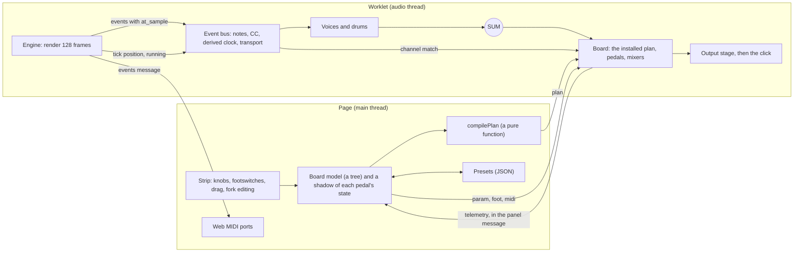

# SPEC-0007 r2: how information moves through the pedalboard

| Field | Value |
|---|---|
| Spec | SPEC-0007, companion file to `README.md` (revision r2) |
| Status | **A proposal. Planning only. Nothing here is approved.** Decisions D15 to D27 are defaults the owner can change, and Q-7-16 to Q-7-21 are the owner's to answer |
| Risk tier | **Low** for this file (`specs/`, `journal/`). Every slice it adds is **Medium** (`apps/web/`, Forge). None touches `contracts/`, the engine, the events or the ABI |
| Owner and approver | `@beaudesign` |
| Task | `WENGE-0037`, the same task as r1 (a spec revision keeps its task, as SPEC-0005's r1.1 to r1.3 kept WENGE-0031). r1's file and its squash commit on `main` say `WENGE-0036`, but that number is taken: `handoffs/WENGE-0036.ndjson` is the Curve engine tests, on `main` since #68. The title of #76 on GitHub already reads `WENGE-0037` |
| Base | `main` at `9977ec0`. Read from the code at that commit, not recalled: `crates/octocore/src/engine.rs`, `domain.rs`, `types.rs`; `apps/web/engine/ABI.md`; `apps/web/src/worklet.ts`, `abi.ts`, `protocol.ts`, `monitor.ts`, `click.ts` |
| Extends | `README.md` section 4 (the board), section 5.9 (MIDI and CV) and section 12 (not done) |

## 1. The ask

Recorded here because chat is not a source of truth. The owner wrote on Mon 2026-10-19 at 22:41 London, with two pictures:

> Sequencer performance improvements - Let's think about implementing and planning a pedal chain like this which goes under the sequencer itself - think of about the data and information flow

**How it is read.**
- **Picture 1** is the resonator pedal that section 5 already models as pedal 1. Nothing about it changes.
- **Picture 2** is a four-slot pedalboard from another app: Overdrive, Distortion, Mixer, Phaser, with routing lines drawn above the slots and an A to B fader on the Mixer. As I read it, the chain forks into two lanes (Overdrive and Distortion) that rejoin in the Mixer, and carries on to the Phaser. That is a shape r1 lists as "not done" (section 12). It is the one new requirement the pictures add.
- **The pictures are used for topology only.** Their look is not taken (`CLAUDE.md` rules 4 and 6; Q-7-2), and the images are not stored in the repository (rule 7).
- **"Performance" is read as playing the sequencer live**: what the sequencer can do to the pedals while it plays. If CPU cost was meant, PB-8, PB-21 and PB-23 are its guards (Q-7-16).

## 2. What is on `main` (read from the code)

| Fact | Where |
|---|---|
| An engine event is 12 bytes: `kind` (0 note on, 1 note off, 2 control change, 3 pitch bend, 4 channel pressure, 5 real-time), `port`, `channel` (1 to 16), `d1`, `d2`, and `at_sample`, the offset inside the block. A render holds up to 256 note-side and 256 clock-side records | `apps/web/engine/ABI.md`, `abi.ts` (`decodeEvents`) |
| `process()` reads `running` and the tick position, calls `engine.render(128)`, decodes the events (a fresh array each block), posts them to the page as an `events` message (this is what leaves for Web MIDI), then adds the click, then `monitor.render(out, notes)` adds the built-in sound into the **same** `out` buffer, sample by sample. The output is one channel (`outputs[0][0]`) | `worklet.ts` |
| The monitor reads **note events only**. Control change, bend, pressure and clock records are ignored by it | `monitor.ts` |
| The click is derived from the tick position before and after the render, interpolated across the block. It does not use clock records | `click.ts` |
| Clock records (kind 5) exist only **while the engine is clock master** (`octoweb_set_clock`). That switch is about the MIDI port | `ABI.md` |
| The tick is 48 to the quarter note. A MIDI clock pulse is `TICKS_PER_CLOCK` = 2 ticks, 24 to the quarter | `click.ts`, `abi.ts` |
| **Step-locked control change already exists in the engine.** A track has an MCC target (`Mcc::Cc(n)`, `Bend` or `Pressure`) and a step has an `mcc_value`. The engine schedules the message at the step's due time, the same way it schedules the note | `domain.rs`, `engine.rs` (about line 1553) |
| **The page cannot write one.** `STEP_ATTR` has six attributes (active, skip, pitch offset, velocity offset, length, strum); `TRACK_ATTR` has pitch, velocity and MIDI channel. The demo pattern carries no MCC | `abi.ts`, `demo.ts` |
| A track's MIDI channel can be set from the page (`TRACK_ATTR.midiChannel`) | `abi.ts` |
| The engine emits no Program Change | `ABI.md` (kinds 0 to 5) |
| Page to worklet messages: `input`, `transport`, `tempo`, `track`, `step`, `chordStyle`, `clock`, `metronome`, `monitor`, `drums`, `reset`. Worklet to page: `ready`, `events`, `panel`, `error`. `panel` goes about every 21 ms (every 8 blocks) and carries LEDs, playheads, status and the tick position | `protocol.ts` |

## 3. The six flows



| # | Flow | From and to | Timing | Where |
|---|---|---|---|---|
| F1 | **Audio** | voices and drums (and the kit) into SUM, through the board, to the output stage | every sample, in 128-frame blocks | worklet only |
| F2 | **Performance events**: notes, control change, bend, pressure; clock and transport | engine to the pedals whose channel matches | sample-accurate: `at_sample` inside the block | worklet only. The same notes also leave for Web MIDI |
| F3 | **Parameter writes** | knob, hardware controller, sequencer CC, CV cable or preset load, into one pedal's parameter | page: applied at the first sample of the next block. CC: at its own sample. CV: at control rate | page to worklet (`param`) |
| F4 | **Structure** | a board edit becomes a compiled plan, installed in the worklet | on an edit, at a block boundary | built on the page, installed in the worklet |
| F5 | **Telemetry** | worklet to page: LED values, looper state, limiter reduction, cost, tails | inside the existing `panel` message, about every 21 ms. Lossy by design | worklet to page |
| F6 | **Saved state** | board and pedal presets, the user chord, the user scale | on save or load, and 3 s after a change (r1 section 5.1) | page only |

**Four rules the flows obey.**
1. **One way.** Audio and events go engine, voices, board, destination. No pedal writes to the engine, to the events, or to another pedal. A pedal has no MIDI out, as the real one has none (r1 section 12). This is PB-12.
2. **The worklet never waits for the page.** Any message can be late or dropped without a glitch. The page reads the DSP only through telemetry (PB-19).
3. **One writer per value at each sample.** The pedal instance in the worklet owns the effective value of each parameter. The page holds a shadow it refreshes from telemetry.
4. **Time is in samples.** Events by `at_sample`, derived clock pulses by sample, plan installs at block boundaries. Nothing on the audio path uses a timer or a wall clock.

## 4. Who owns which state

| State | Owner | Copies | Note |
|---|---|---|---|
| The pattern, the tempo, the transport | the engine | the page reads LEDs, playheads and the tick position | unchanged |
| A voice's patch (SPEC-0004) | the page model | the instance in the worklet | unchanged |
| The board's structure | the page model (a tree) | the compiled plan in the worklet | the plan is derived and can be thrown away and rebuilt |
| A pedal's **effective** parameter values | the pedal instance in the worklet | a shadow on the page, from telemetry | what the ear hears |
| A pedal's **stored** parameter values (per layer) | the page model | the instance | what a preset saves |
| A pedal's DSP state: delay lines, loop, tails, grains | the worklet only | none | serialised only by `getState` for a preset, and only the parts r1 section 5.9 lists |
| Big buffers (the 20 s loop, grains, reverb lines) | **allocated on the page**, transferred in the install message | the worklet | D22 |
| Presets | page storage (Q-7-21) | none | JSON |
| Telemetry | derived | none | never stored, never an input to anything |

**How a parameter's value is resolved (D23).**
- Writers: **(1)** a knob on the page; **(2)** a hardware MIDI controller (relative knob, r1 D13); **(3)** the sequencer's control change; **(4)** a CV cable, for mapped knobs and TOUCH only; **(5)** a preset load.
- The value is the **latest write among 1, 2, 3 and 5**. Two writes at one sample are applied in event order.
- A **mapped CV input overrides** the stored value until it is unmapped (r1 section 5.9: "A mapped knob is taken over by the jack.").
- A **drag on the page is a write with a sequence number.** While the finger is down the page ignores telemetry for that parameter, so the echo cannot fight the drag.
- **Smoothing** (`ParamDef.smoothingMs`) is applied after resolution.
- A **save stores the stored value**, never the CV-driven one, so CV motion does not end up in presets (r1 section 5.9: CV mapping is not saved).

## 5. How the sequencer reaches the pedals

### 5.1 The key is the MIDI channel (D16)

- Each pedal has a MIDI channel (r1 section 5.9: default 1, the model accepts 1 to 16).
- An engine event carries the channel of its track, which the page can set (`TRACK_ATTR.midiChannel`). **A pedal hears an event when the channels match.**
- The port is ignored in the worklet. Port A or B only decides where the MIDI goes outside the page.
- Real-time messages (clock, start, stop) have no channel. Every pedal that listens hears them. Ghosts' CC 51 and 52 can make it ignore clock or transport (r1 section 5.9).
- There is no routing screen in v1. The routing is the same one the owner's hardware chain would have: set the track's channel to the pedal's.

### 5.2 What each kind of event does

| Engine event | Reaches | What the pedal does |
|---|---|---|
| Note on and off | the pedal on that channel, if it declares notes | Ghosts: **Takeover.** The note retunes one of the six resonators (r1 section 5.4, G-12). The built-in voice plays the note too (D26) |
| Control change (from a step's MCC) | the pedal on that channel | the CC map of r1 section 5.9: CC 14 to 34, 51, 52, 60, 80, 81 |
| Pitch bend, channel pressure | pedals that declare them | Ghosts declares none, so it ignores them |
| Program Change | **nothing from the engine** (it has no such event) | from the page's preset picker or a hardware controller only |
| Clock, Start, Continue, Stop | every pedal that listens | derived in the worklet (5.3) |

### 5.3 Clock and transport are derived, not copied (D17)

- **Why.** The engine's clock records appear only while it is clock master, and that switch is about outgoing MIDI. A Touch Mode must not lose the beat because the owner turned the outgoing clock off.
- **How.** Exactly as `click.ts` does for the click. The worklet already reads the tick position before and after `engine.render`. The 24-per-quarter pulses, one every 2 ticks, that fall in `[p0, p1)` are placed at the frame the interpolated position gives, clamped to the block. A pulse on the start is in and one on the end is out, so a run cut into blocks at any places finds every pulse once. At the top of the tempo range (up to 999 BPM) one block can hold two pulses, so the derivation loops, as `beatsIn` does.
- **Start, Continue, Stop** come from `running` and the tick position at block boundaries. Not running to running at tick 0 is `Start`; anywhere else it is `Continue` (the engine carries on after a Stop, and the engine's own comment cites ADR-0009 amendment 1 for this); running to not running is `Stop`. Transport changes are handled between blocks, so they land on the first sample of a block.
- **Two views of one clock.** A pedal gets `midi(atSample, bytes)` (the hardware-faithful view; Ghosts wants this) and, if it asks, `clock(atSample, tick, ticksPerSample)`. The second is for a pedal that snaps to beats (the loop's synced lengths, the Rhythm Generator). Tempo reaches it at the sample it reaches the engine, not when the page's tempo field changes.
- **When the clock master is on**, the engine's own clock records go to the MIDI port as today and are **not** also fed to the pedals. The pedals' clock is always the derived one, so there is never a double pulse (PB-14).

### 5.4 No extra latency for events

A pedal gets an event at its `at_sample`, in the same block as the voice that plays it. The board's reported latency (at most 64 samples, r1 D4) is added to the **audio** only. The audio is therefore up to 1.33 ms behind the MIDI that leaves for the ports, as r1 PB-6 already accepts for the live page, and the offline renderer compensates.

### 5.5 What a pedal hears is what the ports carry (PB-22)

The same decoded records feed the Web MIDI send and the pedal bus. An external synth and a pedal on the same channel hear the same notes in the same order.

## 6. The shape of the board

### 6.1 A series-parallel tree (D18)

```ts
type Chain = Item[];
type Item =
  | { kind: "pedal"; id: string; type: string; state: PedalState }
  | { kind: "fork"; id: string; lanes: Chain[]; mix: { position: number } };   // v1: two lanes, closed by a Mixer
interface Board { chain: Chain }
```

- A **fork** splits the signal into lanes and a **Mixer** closes it. This is picture 2: two pedals side by side, an A to B fader, then the next pedal.
- A lane may be **empty**, which is a wire. An empty lane against a pedal lane is a dry and wet blend for **any** pedal, including one with no MIX of its own.
- **Why a tree and not free cables.** It is acyclic by construction, so there is no feedback loop to police. Every node is reachable. The strip can draw it as rows one under another. A send and return later is a new kind of node, not a rewrite.
- **v1 limit (D18): one fork, two lanes, no nesting.** The data model already holds a list of lanes, so more lanes or nesting later is a change to a limit and not to the model (Q-7-17).
- **The Mixer's law (D19)** is a linear A to B: gains `1 - x` and `x`. Two identical lanes give unity at every position, so a bypassed pedal in one lane does not get louder at the centre. The generic `blend` of r1 section 4.2 stays equal-power, because it blends a pedal with its own dry signal for a different purpose.
- **Channels (D2 of r1).** A lane ends with the channel count of its last pedal, or of its input if it is empty. The Mixer outputs 2 channels if either lane has 2, and a mono lane is duplicated into both.

### 6.2 Latency, and keeping the lanes aligned (D20)

- Every pedal reports `latencySamples(state)`. A lane's latency is the sum over its pedals.
- The Mixer **delays the shorter lane by the difference**, so the lanes line up. Without that, two lanes of unequal latency mixed together make a comb filter.
- The board's total is the largest path. The 64-sample budget of r1 D4 applies to each path and to the total. The compensation delay is part of the plan and is sized when the plan is compiled (at most 64 samples).

### 6.3 From tree to plan (F4)

- `compilePlan(board, sampleRate)` is a **pure function** with no reference to the DOM, the worklet or the clock. It returns plain, structured-cloneable data: a flat list of steps (`run`, `copy`, `mix`, `delay`) with buffer indices, the channel count on each buffer, the latency per path, and the sum of the pedals' declared cost.
- The same tree always gives the same bytes (PB-16). That is what makes the board testable in Node without a browser.
- **Install.** The page posts the plan and, for each new pedal, its state and its memory (D22). The worklet keeps instances by id: a pedal in both the old and the new plan keeps its instance and its state. A pedal that is no longer in the plan is dropped and its tail ends.
- **Applying it** is at the first sample of the next block, by the duck-swap of 9.1 (D21).
- **Idle (PB-23).** The monitor already skips blocks with nothing sounding. The board does the same: with silent input and every pedal's `tailSeconds` expired, it does no per-sample work.

## 7. Messages between page and worklet

Additions to `protocol.ts` (plain objects, structured-cloned). Nothing existing changes.

```ts
// page to worklet
| { type: "board"; plan: Plan; pedals: { id: string; type: string; state: PedalState; memory?: ArrayBuffer }[] }   // memory is transferred
| { type: "param"; pedal: string; id: string; value: number; seq: number; source: "ui" | "controller" | "preset" }
| { type: "foot"; pedal: string; id: string; down: boolean }
| { type: "midi"; bytes: Uint8Array }          // a hardware controller; applied at the first sample of the next block
// worklet to page: a new field on the existing panel message (D24)
board?: { params: { pedal: string; id: string; value: number; ackSeq?: number }[]; leds: ArrayBuffer; cost: number; tails: number }
```

- `board` is present only when something changed, as `leds` already is. No new message and no new cadence.
- A hardware controller's bytes carry no sample time. The page has no sample clock, so they are applied at the first sample of the next block, the same way the panel's `input` message is. The jitter is at most one block, 2.7 ms.

## 8. What this gives the player

| # | Gesture | Data path | Possible today? |
|---|---|---|---|
| A | **The sequence tunes the resonator.** A track's notes retune its six voices (Takeover) while the sound plays through it | F2, notes by channel | **Yes, with no engine work**: set the track's channel to the pedal's. Needs P0a and G4 |
| B | **The loop, the grains and the drums follow the sequencer's beat and transport** | F2, derived clock | **Yes, with no engine work**: derived from the tick position. Needs P0a, G6 and G7 |
| C | **A step moves a knob.** A step's value sweeps DECAY, MIX or TIME at the step | F2, control change from the track's MCC | **The engine already sends it. The page cannot write it yet** (section 2). Needs a request to the Metronome and Forge, and it sits beside SPEC-0003's step events (Q-7-19) |
| D | **Footswitch gestures**: tap to bypass, hold TOUCH for momentary | F3, `foot` | Page only (P1) |
| E | **A parallel lane**: the dry sound and a processed copy, with an A to B fader, so a pedal can be faded in while playing | F4, the Mixer | Needs P2 |
| F | **Scenes**: the pattern and the board recalled together | F6 | Not proposed (Q-7-20) |

A and B are the first things the board can do that the sequencer alone cannot, and neither needs the engine to change. C is the one that makes "the sequencer plays the pedals", and it is blocked by something outside this spec, the same way the Curve button waits for chord entry.

## 9. What this reading found in r1

These are findings, not edits. r1's text and decisions are unchanged except where D21 and 9.5 say so.

1. **The reorder crossfade cannot work as written (r1 section 4.2, Order).** It crossfades "the old chain's output and the new one's". A reorder from A, B to B, A would run the **same stateful instances** in two orders in one block. A delay line or a looper cannot be advanced twice. Copying their state is not an option for a 7.7 MB loop on the audio thread. **Proposal (D21):** duck, swap, unduck: ramp the board output to zero over 5 ms, install the plan, ramp up over 5 ms. The click is mixed after the board and is not ducked. PB-7 still applies.
2. **The r1 diagram sends "notes, CC, PC, clock, start/stop" to the pedals (section 4.1).** The engine has no Program Change, and its clock records exist only while it is clock master (section 2). D17 derives the clock and transport instead.
3. **Mixing order.** Today the monitor adds into `out` after the click. The board needs the voices' sum **alone**, so P0a renders the monitor to its own bus and adds the click after the board. The output with an empty board can stay identical sample for sample (PB-1), because float addition is commutative, but the slice must prove it.
4. **The worklet is not allocation-free today.** `decodeEvents` makes a new array each block. r1's "no allocation after `create`" has to be read as being about the pedals, and the check is on the pedals' `process` (PB-20).
5. **The Stage line of the README was stale.** It said the spec was written outside the repository and nothing was pushed. It has been on `main` since #76. Corrected in r2.
6. **Memory.** The loop is 20 s of stereo at the page's rate: about 7.7 MB at 48 kHz (20 x 48,000 x 2 x 4 bytes), and Terrazzo's 6 s ring about 2.3 MB. At 96 kHz that is twice as much. Allocating that inside the worklet is a stall risk. D22.
7. **Task id.** `WENGE-0036` is taken (see the header), yet r1's file says it. `git grep` finds no use of `WENGE-0037` in the tree; its only mention anywhere is the title of #76 on GitHub. r2 corrects the README's Task row to `WENGE-0037`. The squash commit's title on `main` still says 0036, and history is not rewritten.

## 10. Observables (written red first; they are PB-12 to PB-23, after r1's PB-1 to PB-11)

Tests run in Node on SPEC-0004 S0's rig, seeded, at 48 kHz unless stated.

| # | Observable | Test |
|---|---|---|
| PB-12 | **Events never flow back.** For every pattern in the determinism set, the engine's event bytes with any board (a gain pedal; then Ghosts with every Touch Mode on) equal the no-board bytes, byte for byte. No module under `apps/web/src/board/` calls an engine setter | `board.flow.test.ts`, `app_source_rules.rs` |
| PB-13 | **Routing is by channel.** A scripted stream on channels 1 and 2 reaches a recording pedal on channel 1 at the same `atSample` the monitor sees. None of channel 2's reaches it. A channel change takes effect at the next event | `board.flow.test.ts` |
| PB-14 | **The clock is derived, once.** With the clock master off, a pedal gets 24 pulses per quarter, each within 1 sample of the interpolated tick position, `Start` at tick 0, `Continue` on a resume and `Stop` on stop. At 999 BPM a block holding two pulses delivers both. With the master on, the count is identical (no doubles). Cutting the run into blocks at other places gives the same pulses | `board.clock.test.ts` |
| PB-15 | **Parameter precedence.** A scripted table of writes (page, controller, CC, mapped CV, preset load) gives exactly the effective values of section 4. A telemetry echo never overwrites a held drag | `board.params.test.ts` |
| PB-16 | **The compiler is pure and right.** For 10,000 seeded random trees: every node appears once, channel counts follow 6.1, each path's latency is the sum, the total is the maximum, the plan is plain cloneable data, and the same tree gives identical bytes | `board.plan.test.ts` |
| PB-17 | **A fork lines its lanes up.** Lane A holds a pedal reporting 16 samples of latency, lane B is empty, the Mixer is at the centre: an impulse comes out **once**, at sample 16, at 1.0 within 1e-6. Two identical lanes give the input at every position. Hard A and hard B equal the lanes' own outputs | `board.fork.test.ts` |
| PB-18 | **A swap is quiet and single-order.** Inserting, removing or reordering a pedal during a sustained 1 kHz sine at -6 dBFS never steps the output by more than 0.05, the gap is at most 12 ms, and no instance's `process` is called twice for the same samples | `board.swap.test.ts` |
| PB-19 | **Telemetry is lossy and one-way.** Dropping every `board` field of every `panel` message changes no output sample. No page module imports a `PedalInstance`, only definitions | `board.flow.test.ts`, `app_source_rules.rs` |
| PB-20 | **Nothing big is allocated on the audio thread.** Installing a plan that adds a pedal with a 7.68 MB buffer creates no typed array above 4 KiB in the worklet; the buffer arrives transferred | `board.alloc.test.ts` |
| PB-21 | **Cost is budgeted.** With a bench pedal declaring 0.4 of the budget, the third insertion is refused with a stated reason and the board is unchanged. The cost the page shows is the sum of the declared costs | `board.cost.test.ts` |
| PB-22 | **Inside equals outside.** For a run, the records the pedal bus gets equal the records sent to Web MIDI (kind, channel, `d1`, `d2`, `atSample`), in order | `board.flow.test.ts` |
| PB-23 | **Idle is free.** With silent input and every tail expired, no pedal's `process` is called and the output is exactly the click. A note start resumes processing in the same block | `board.idle.test.ts` |

PB-1 is restated for P0a: with the monitor on its own bus and an **empty** board, the output equals today's sample for sample. These names go into `harness/baseline.txt` when the tests are built, and not before.

## 11. Slices (each one PR, red first; Forge, Medium)

| Slice | Content | Rows | Needs |
|---|---|---|---|
| **P0a** (new) | The bus: the monitor on its own bus; events, derived clock and transport delivered to a recording test pedal by channel; the click after the board. No sound changes | PB-1, PB-12, PB-13, PB-14, PB-22 | SPEC-0004 S0 (merged, #73); this spec approved |
| **P0** (r1, widened) | r1's series board, now with the plan compiler for series chains, the parameter plane, telemetry in `panel`, the duck-swap, memory transfer, the cost budget and idle skip | r1's rows, and PB-15, PB-16 (series), PB-18 to PB-21, PB-23 | P0a; ADR-0015 |
| **P1** (r1) | The strip on the page, series only: cards, footswitches, drag to reorder | r1's rows | P0 |
| **P2** (new) | The fork and the Mixer: the compiler's fork cases, delay compensation, and the strip drawing two lanes and a Mixer | PB-16 (fork), PB-17 | P1 |
| **G0 to G8** (r1) | Unchanged. G4, G6 and G7 now also need P0a | as r1 | as r1, plus P0a |

All are Medium: `apps/web/` only. None edits `contracts/`, the engine, the events or the ABI. Order: P0a, P0, P1, P2, then the G slices as r1 has them. The owner has approved none of these.

## 12. Decisions for the owner (defaults are taken; change any)

| # | Decision | Default and why |
|---|---|---|
| D15 | The direction of flow | **One way**: engine to voices to board to destination. No pedal writes to the engine, the events or another pedal (PB-12) |
| D16 | How the sequencer reaches a pedal | **By MIDI channel**: a track's channel equals the pedal's. No routing screen in v1 |
| D17 | Clock and transport for pedals | **Derived in the worklet from the tick position**, as the click is, so they work with the outgoing clock off. Pedals get MIDI bytes and, if they ask, the tick position |
| D18 | The board's shape | **A series-parallel tree.** v1 allows one fork of two lanes and no nesting. The model holds a list of lanes |
| D19 | The Mixer's law | **Linear A to B**, unity for identical lanes. The generic `blend` stays equal-power |
| D20 | Lanes of unequal latency | **Delay-compensated** by the Mixer. 64 samples per path and for the total (r1 D4 kept) |
| D21 | Changing the board while playing | **Duck, swap, unduck** (about 10 ms), not a crossfade of two chains (9.1). Amends the last bullet of r1 section 4.2 "Order" once approved |
| D22 | Big buffers | **Allocated on the page and transferred**, never created in the worklet |
| D23 | Which value wins | As section 4: the latest write; a mapped CV overrides; a drag takes over; a save stores the stored value |
| D24 | Telemetry | **In the existing `panel` message**, lossy |
| D25 | Sequencer control change to parameters | **Only through the pedal's CC map** (r1 section 5.9). No separate automation lanes and no routing table in v1 |
| D26 | A note that also goes to a pedal | **The built-in sound still plays it.** Routing silences nothing |
| D27 | The cost budget | Each pedal declares its worst-case cost per block, and the board refuses an insertion past the budget. The fraction is a **stand-in** (70% of the block's real time) until PB-8 has measured the first pedal |

## 13. Questions only the owner can answer

- **Q-7-16. What does "performance" mean here?** Playing the sequencer live (default, and how this file reads it) or CPU cost? If CPU, D27 and PB-8, PB-21 and PB-23 are the guards, and no other change is needed.
- **Q-7-17. How big may a fork be?** One fork with two lanes and no nesting (default, as picture 2 shows), or more lanes, or nested forks?
- **Q-7-18. Should a track be able to send to a pedal only,** silencing the built-in sound on that channel? Default: no (D26). Nothing is silenced by routing.
- **Q-7-19. Step-locked control change.** The engine already sends a track's MCC; the page cannot write one. Should the page get a way to do so before SPEC-0003's step events (a request to the Metronome and Forge now), or after (default)? Until then gestures A and B work and C does not.
- **Q-7-20. Scenes.** Should the board's state travel with the pattern as one thing? Default: no, they stay separate files.
- **Q-7-21. Where do board presets live** until the page has persistence (the `persistence` gate is `not_implemented`)? Default: JSON files the owner downloads and uploads. A real store needs its own ADR.

## 14. Risks

- **Gesture C stays out of reach** until the page can author an MCC. Gestures A and B are real without it. The risk is that the owner expects "the sequencer moves the knobs" from the first slice. Section 8 says plainly that it will not.
- **A derived clock has no bar position.** MIDI clock never had one, and the pedal's synced modes count from Start. If a later pedal needs bars it needs the page length from the engine, which is a separate request.
- **Cost on phones** is the same risk as r1's, with a guard now (D27, PB-21).
- **The fork is optional.** If it proves heavy, P2 can be dropped and nothing before it changes.
- **The wording check.** This file was checked against `harness/scope-banned.txt`.

## 15. Not done

- Free cables, send and return, nested forks, more than two lanes.
- A routing screen. Automation lanes separate from the MCC.
- MIDI out from a pedal.
- Scenes. A storage backend.
- Any change to the engine, the events, the ABI, `contracts/` or SPEC-0004's text.

## 16. Approval record

Not approved. Awaiting `@beaudesign`. The owner's message of 2026-10-19 (section 1) asked for this thinking; it did not approve a slice. Merging is the owner's act, and a merge is not an approval: approval is the owner's own words written here with the date.
