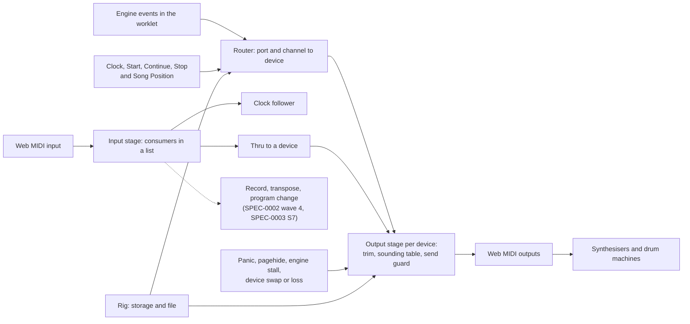

# SPEC-0008: Playing hardware: the sequencer driving real synthesisers, and live MIDI in and out

| Field | Value |
|---|---|
| Spec | SPEC-0008 |
| Revision | r0.1, draft, 2026-10-26 (r0 was merged as #84 on 2026-10-25, which approved nothing) |
| Stage | **Planning only.** It adds no code, contract, fixture or threshold. Every slice, decision and default below is a proposal, not an approval |
| Risk tier | **Low** for the spec itself (`specs/`, `journal/`). Slices H1a, H1b, H2, H5 and H6 are **Medium** (`apps/web/`, Forge). H3 (timing) and H4 (clock) are **High**, as P4 was (`docs/09-roadmap.md`). H0 and H7 are runs by a person with gear and change no file but evidence |
| Owner and approver | `@beaudesign` |
| Task | **`WENGE-0038`** (the next free id: `main` and the pull request titles end at `WENGE-0037`) |
| Extends | SPEC-0002: `product.md` section 6 (the MIDI requirements), criteria A3, A4 and A6, and waves 4 and 5. ADR-0008 (the page sends MIDI with a lookahead) and ADR-0009 (the engine emits the clock). It changes none of them |
| Depends on | **SPEC-0003 S7** for program and bank change, which needs `Event::ProgramChange`, `Event::BankSelect` and ABI revision 3. S7 is planned there and **not approved**: SPEC-0003's record approves S0 and says S1 onward is not approved. This spec does not repeat it |
| Meets | SPEC-0007 r2 (proposed): the worklet's event, clock and transport bus (slice P0a) is where the Song Position of slice H4 would be derived. SPEC-0004: the built-in sound, which slice H5 asks to step aside for a port that has a device |
| ADR | None written. H3 may need an amendment to ADR-0008 (a per-device term beside the lookahead). The rig file format is kept out of `contracts/` (D-H3); if the owner wants it there, that is an ADR |
| Base | `main` at `d0d1992` for r0; r0.1 is written on `main` at `7aebadf`. Everything said about the repository below was read from files on `d0d1992` unless it says *(not re-checked)*; the repository did not change in this spec's area between the two (#85 and #86 are comments and corrections). Section 2.3 is new in r0.1 and is read from outside the repository |
| Companion | **`bench.md`**: the runs only a person with gear can do, and what each one settles |

## 1. The ask

Recorded here because chat is not a source of truth. The owner wrote on Sat 2026-10-24 at 14:10 London:

> Let's spec out how we could use the sequencer with actual hardware synthesisers and live midi - read the docs and think deeply about

(The owner's dash is written as a hyphen here.) The message ends there. It is a request to think and plan, not an approval.

**How it is read.** "Actual hardware synthesisers" means external instruments that speak MIDI: a class-compliant USB synthesiser, a synthesiser or drum
machine on a MIDI cable behind a USB interface, several of them at once. "Live midi" means MIDI used in performance, in both directions: the sequencer
driving the gear steadily and safely for a whole set, a keyboard or controller played into it, and clocks and transport exchanged with other gear.
Ableton Live is already covered by `apps/web/ABLETON.md`; it appears here only where hardware changes the answer (section 4.9). If "live" meant
something narrower, Q-8-2 is where to say so.

## 2. What exists today

### 2.1 In the repository (read from the code, not recalled)

| Area | What is there | Where |
|---|---|---|
| Ports | Two output ports. A track's channel 1 to 16 is port 1 and 17 to 32 is port 2. Each port sends to one device chosen on the strip; nothing is sent to a port with no device | `midi-out.ts`, `settings.ts`, `app.ts`, `ABI.md` |
| Events out | Note On and Off, CC (a track's MCC), pitch bend (14 bits), channel pressure, and the real-time messages Clock, Start, Continue and Stop. **No** program change, bank select, song position, NRPN or system exclusive | `ABI.md` (kinds 0 to 5) |
| Timing out | An event at audio time `at` is stamped `toPage(at) + L` and sent with `MIDIOutput.send(data, timestamp)`. `L` is one setting for every device, 30 ms by default, 0 to 250. An event already late is sent at once and counted. Timestamps on one device never go backwards. `MIDIOutput.clear()` is never called | `midi-out.ts` |
| Stop | The engine turns off every note it owes (one Note Off for each Note On, so a retriggered pitch is released once per strike), then sends CC 123 on the channels that had one. A Stop pressed while stopped sends CC 123 on all 32 channels, as the manual says (p. 94) | `engine.rs` (`flush_pending`, `flush_cc`), `AMBIGUITIES.md` |
| Clock | Four states with the manual's names: Off, Master Clock, Slave Clock, Slave Clock with MIDI Clock echo. Master sends a Clock every 2 ticks (24 to the quarter note), Start or Continue, and Stop to **every chosen device, once each**. A step is 12 ticks, which is six pulses, a sixteenth note | `clock-state.ts`, `ADR-0009`, `abi.ts` (`TICKS_PER_CLOCK`) |
| MIDI in | One chosen input. Messages are decoded (notes, controllers, bend, pressure, **program change**, the four real-time messages) and counted. **Only the clock uses them.** There is one consumer slot, `InputPath.onMessage` | `midi-in.ts`, `app.ts` |
| Browser | Chrome and Edge. A secure context. The page does not ask for system exclusive. A page with no Web MIDI, or a refusal, runs and says so | `midi-access.ts`, `ABLETON.md` |
| Test stand-in | `FakeOutput`: a queue that delivers by timestamp, lets an unstamped send overtake it, and holds a note from Note On to Note Off | `test/support/receiver.ts` |
| Evidence | Spike S1 ran against a **page timer**, never a MIDI port (30 s, tab hidden for 30.1 s; it predates the tick-length decision, so its steps were 31.2 ms and not 125 ms). Spike S3 ran against a **simulated** sender. `ABLETON.md` says in so many words that nothing has run against Live or a real port. Criteria **A3** (note timing at the receiver), **A4** (clock follow) and **A6** (a real synthesiser on port 1 and a second device on port 2, with the gear named) are unset or unrun | `handoffs/evidence/p3-s1-here-*.txt`, `ABLETON.md`, `product.md` section 9 |

### 2.2 In the manual (pages 46, 50 to 51, 74, 78, 85, 87 to 94; my summary, in my words)

These are the instrument's own hardware behaviours. They are what "works as the manual says" means for gear.

- **Channels.** Every track starts on channel 1 of port 1. The MCH encoder runs 1 to 16 (green, port 1) and then 17 to 32 (red, port 2).
- **Controllers.** A track can send one CC per step (MCC), or pitch bend, or channel pressure. CC resolution sends one to seven messages per step (SPEC-0003's table, citing p. 53, a page I did not read).
- **Program and bank change.** In Track mode the Program key sends a program change on the track's channel (0 means none, 1 to 128 otherwise). Select toggles to a bank number. **All of a page's program changes and bank changes are sent once when the page is enabled for play.**
- **Clock.** Off by default. Master sends clock and transport out of both ports. Slave listens on one port, found automatically, and can echo the clock out.
- **ALL NOTES OFF.** Stop pressed while stopped, with the clock master or slave, sends CC 123 on all 32 channels.
- **Recording.** With a track armed, MIDI in is **re-channelled** to the armed track and routed through, even in stop mode, so one keyboard plays every track's instrument. Note stream, step-note and chord stacking, controller streams (the track senses the controller), a switch that mutes playback while recording (Anti-Echo), force-to-scale, and "MIDI merge" through a chromatic page scale (notes only).
- **Keyboard transpose.** Per track, a listen channel; relative or absolute; a note struck harder than velocity 88 restores the original pitch.
- **External program change.** Channel 10 selects a grid set; channels 1 to 9 toggle pages in the bank of that number. Only in slave clock mode, armed from Grid mode.
- **Page set as MIDI controller.** Row 0 steps send a note on the measure, on one global channel, to start a drum machine.
- **MIDI control maps.** Six maps, which p. 74 calls global, from a MIX knob to a CC on a channel, with learn from MIDI in. Whether they are global or per page is one of the questions the manual's tutorials leave open (`tech.md` section 9, item 4).
- **Sysex.** Page, bank and grid dumps, and transfers to and from the Nemo (pages 111 to 112 read; 95 to 97 from the manual's index and page 95 only). **Not in this spec.**

### 2.3 The owner's gear (Q-8-1, answered in part on 2026-10-26)

On Mon 2026-10-26 at 14:37 the owner wrote "Udo desktop and a mother 32". I read that as a UDO Super 6 desktop module and a Moog Mother-32 and said so; the owner replied "Yes correct" at 14:38. This answers the first half of Q-8-1 (which gear) and none of the second (how it is connected, which computer and browser, whether there is a loopback). It approves nothing.

**What I read, and how well.** Web pages through a tool that returns a summary of the page, not the page: a Sound On Sound review of the Mother-32, three Moog forum threads and one personal blog post about it, a third-party copy of the UDO Super 6 Owner's Manual, version 2.0 (August 2020), and a retailer's page for the Super 6 Desktop. **I did not read Moog's own manual** (the copy I could open had no MIDI chapter) **and I did not read the Super 6's MIDI chapter** (its pages 92 to 96, and the global settings on pages 83 to 85, were cut off). A claim from a forum is a user's report, and is marked so. Nothing here was tried on a unit.

| | UDO Super 6 (desktop module) | Moog Mother-32 |
|---|---|---|
| What it is | 12-voice polyphonic analog-hybrid, with an arpeggiator and a 64-step sequencer (retailer's page) | A one-voice analog semi-modular with a 32-step, 64-memory sequencer. The review calls the sequencer monophonic; that the whole unit is one voice is general knowledge, not checked |
| What connects | Owner's Manual, p. 22: a class-compliant USB port with bidirectional MIDI (no driver), and MIDI In, Out and Thru on 5-pin DIN. That manual covers the Super 6; I did not see a statement about the desktop module's connectors | The review says there is **no MIDI Out and no Thru**. I found no USB MIDI port described. So a browser reaches it only through something with a DIN output *(not checked: what that is here)* |
| Channel | Not read | Set in Setup mode, 1 to 16 (review) |
| Messages it takes | Not read | Notes, velocity, aftertouch, pitch bend, mod wheel, several CCs (1, 2, 4, 7 are named as sources for its assignable output), Program Change to pick a sequencer memory, MIDI Clock, Start, Stop and Continue (review, second-hand) |
| Clock and transport | Its LFO 1 and delay time can sync to an external MIDI clock (manual pp. 47, 58). Start, Stop and Song Position not read | With a clock in, the Tempo knob becomes a clock divider (the manual, as a forum user quoted it). **User reports:** by default it **follows MIDI Start and Stop**, starting its own sequencer, and **ignores incoming notes while that sequencer is running**; Setup page 8, "Follow MIDI Start/Stop", turns that off (firmware v2.0) |
| Panic | Nothing found on CC 120 or CC 123 | Nothing found on CC 120 or CC 123 |

**What this suggests for the plan.** All proposals; none changes a slice.

- **The first real pairing is a polyphonic USB synthesiser and a one-voice DIN one.** That is criterion A6 almost word for word (port 1 a synthesiser, port 2 a second device), and it is the best case for B3 (two devices lined up): a USB path and a DIN path will not have the same latency, so per-device trim (H3) has a real job.
- **Transport is a trap with this gear, and the spec's own default meets it.** D-H7 sends Start, Stop and Continue to every chosen device. If the user reports hold, our Start would start the Mother-32's own sequencer, and it would then ignore the notes we send. Section 4.5 and Q-8-12 carry the choice.
- **A one-voice device and a chord track.** The sequencer can put a chord or a strum on a track (up to 16 notes). Routed to the Mother-32 it can sound one of them; which one is unknown *(not checked: its note priority)*. The route sheet (H2) could mark a device as one-voice and the track-to-device view could say so. It is not in any slice; say if you want it.
- **Panic.** Since neither unit's reply to CC 120 or CC 123 is known, Release and Cut (section 4.4) do not rely on them: the sounding table sends a Note Off for every note it owes first, and the CCs are the extra.
- **Channel.** The route's channel rewrite (section 4.2) means the Mother-32 need not be reconfigured to match a track; the track's channel can be mapped to whatever the unit listens on.
- **A stand-in for the drum machine.** The Mother-32's sequencer, running on our clock with Follow MIDI Start/Stop on, could stand in for the drum machine in B6 and B7. Whether it plays its first step on Start or on the next clock is exactly what B7 asks and has not been measured.

## 3. What is missing for gear: findings

Each one is a sentence, the file that shows it, and what I did not check. None is a defect of the work so far; they are what stands between a page that plays a
demo and a page that survives a set.

| # | Finding | Shown by |
|---|---|---|
| **F-H1** | **Nothing persists.** No `localStorage` or other storage is used in `apps/web/src` or `pages`, so a person with three synths picks every device again on every load. SPEC-0002 P3 left "saving the lookahead or the output across visits" out on purpose | grep of `src/` and `pages/`; `p3-plan.md` |
| **F-H2** | **A track's channel cannot be set from the page.** The panel's Track zoom (the MCH row) is not built; the stand-in is `?route=0:17,1:3` in the address, read once at start | `route.ts`, `README.md` ("The route hook") |
| **F-H3** | **One lookahead for every device.** Two synthesisers with different note-to-sound delays, or a drum machine and a synthesiser, would flam, and there is nothing to align them with | `MidiScheduler.lookaheadMs` |
| **F-H4** | **Changing a port's device while a note sounds hangs it.** `setOutput` replaces the output and forgets its timestamp record; it sends the old device nothing. The Note Offs the engine still owes are addressed to the port, so on the next Stop they go to the **new** device, which never heard the Note On | `midi-out.ts` `setOutput` |
| **F-H5** | **A send that throws ends the batch.** There is no `try` in `midi-out.ts` or `wire.ts`, so if one device's `send` throws, the remaining records of that batch, for every other device, and their Note Offs, are not scheduled. *(Not checked: whether Chromium's `send` to a port that has gone away throws, rejects or is ignored; the Web MIDI text, as I remember it, says a disconnected port throws.)* | `midi-out.ts` `schedule`, `wire.ts` |
| **F-H6** | **There is no panic on the page, and the obvious one is wrong.** Stop's flush is made in the engine and reaches the device through the worklet and the scheduler, so it cannot help if the worklet has died. A page-side panic that sends Note Offs at once is overtaken by Note Ons already queued with a future timestamp, which makes the hung note it was meant to cure (`receiver.ts` models exactly this: an unstamped send "can overtake what is queued") | `midi-out.ts` header, `receiver.ts` |
| **F-H7** | **Nothing handles the tab being hidden for long, or closing.** There is no `visibilitychange` or `pagehide` handler. The only hidden-tab evidence is 30 s against a page timer, where `tech.md` asked for 30 minutes, and it does not say whether the page was making sound (a tab that is silent may be treated differently from one that is not; *not checked*) | grep of `pages/`, `src/`; `p3-s1-here-*.txt` |
| **F-H8** | **Continue goes out without a Song Position, and an incoming Song Position is ignored.** A device that was switched on late, rewound by hand, or lost a clock resumes from its own place, not ours | `ABLETON.md` sections 4 and 8; `ADR-0009` |
| **F-H9** | **The first note after Start is 11 ticks late.** Start and the first Clock share a sample; the first step fires when its counter reaches the step length, so the first note is on tick 11. At 48 ticks to the quarter note that is 114.6 ms at 120 BPM, almost exactly one step (12 ticks) and not zero. A drum machine slaved to our Start plays its first step at Start. This is `R0b` in the Conductor's notes: no reading in the manual says which is right, and changing it moves every golden. The 11 ticks is current; the time ADR-0009 amendment 1 gives for it (28.6 ms, 1.4 pulses) dates from the old tick length and is stale | `AMBIGUITIES.md` ("the first note after Play"), `ADR-0009` amendment 1 item 3, `abi.ts` |
| **F-H10** | **The built-in sound plays every track, whether or not a device is also sounding it.** `monitor.ts` reads note events and has no notion of port; its drums play any note on channel 10, on either port. With a synthesiser connected the person hears both. The Drums button silences only the drums | `monitor.ts`, `README.md` |
| **F-H11** | **MIDI in has one consumer and no route to an output.** Nothing forwards a keyboard to a synthesiser; the manual's re-channel behaviour, recording, transpose and external program change are all unbuilt (SPEC-0002 wave 4). Program change is decoded and dropped | `midi-in.ts`, `app.ts` |
| **F-H12** | **The echo can feed itself, and the page cannot see it.** `ABLETON.md` says so for a virtual port. A real device usually lists its input and output under one name, so a name check can catch the common case | `ABLETON.md` section 3, item 4 |
| **F-H13** | **Stale lines.** `ABLETON.md` section 8 says the tick length is open (it was decided on 2026-10-07) and a step is "1.5 pulses" (it is six); `apps/web/README.md` ("The MIDI clock") says the engine sends a Clock "every 8 ticks" (it is every 2: `TICKS_PER_CLOCK`); `reference/manual/INDEX.md` sends the topic "midi" to pages 109 to 112 (a song grid chart and the Nemo sysex notes) and not to pages 93 and 94. Not fixed here | `ABLETON.md`, `apps/web/README.md`, `INDEX.md`, `abi.ts` |

What I could not do: run anything against a real port or a real instrument. There is no hardware in the environment this was written in, and I did not look for a MIDI backend there (P4b found that Chromium reports
`InvalidStateError` where there is none, `midi-access.ts`). So every test this spec describes runs against a stand-in, and the stand-in encodes what its author believes
a synthesiser does. A green test proves the page's logic. Only the bench proves the integration, which is `docs/03` section 7's own rule ("the synthetic number proves the core is right; the loopback number proves the integration is").

## 4. The design

### 4.1 One idea

The engine is the instrument and stays the manual's. **The page owns the world of devices**: which are plugged in, which track reaches which, how late each one
sounds, what is sounding on each, and what to do when something goes wrong. Three pieces, all in `apps/web/`:

- the **rig**: the named devices, the routing from (port, channel) to a device, and the settings of each device, kept across visits;
- the **output stage**: one object per device that stamps, tracks and guards what goes out;
- the **input stage**: what listens to MIDI in, and the one time function that anything recorded will use.

No engine change, no ABI change and no `contracts/` change is needed for anything except program and bank change, which SPEC-0003 S7 already plans.



### 4.2 The rig

A **device** is one Web MIDI output (and, if it has one, its input), with a label the person chose. A **route** sends a range of the engine's addresses to a device.

```text
rig       = { version, name, devices[], routes[], input }
device    = { key, label, outId, outName, inId?, inName?, trimMs, clock, transport, panic, channelLabels? }
route     = { port: 1 | 2, from: 1..16, to: 1..16, device: key, channel: "same" | 1..16 }
```

- **The default rig is today.** Port 1 channels 1 to 16 go to the device chosen for port 1, port 2 to the device chosen for port 2, channel unchanged. With the
  default rig the scheduler's output is byte for byte and timestamp for timestamp what it is now (HW-1).
- **Why routes, not "a port is a device".** The engine has two ports of sixteen channels, the Octopus's two cables, each of which on a real desk carries a chain of devices
  told apart by channel. A page with three USB synthesisers has three outputs and only two ports. Routing by channel does in software what the chain does on the cable:
  channels 1 to 3 to the lead synthesiser, 4 to 9 to the bass, 10 to the drum machine. The optional `channel` rewrite covers two devices that both insist on receiving on
  channel 1: send one from port 1 channel 1 and the other from port 2 channel 1, and rewrite both to 1. The manual never needs this (a track's channel is set to match
  the device); the rewrite is an addition and defaults to "same".
- **Binding.** A device is found by its port `id` first. If the `id` has changed, it is found again by name and manufacturer, **only when exactly one port matches**.
  Two identical interfaces are never guessed between: the rig asks. A device that is not plugged in is shown as missing and keeps its routes; when it returns it is bound again. Whether
  Chromium's `id` is stable between visits is *not checked*, which is why the name fallback exists.
- **Nothing goes out on load.** A rig read from storage sends no byte until the person presses Play or an explicit test button (HW-5).
- **Where it lives.** The browser's storage for the page, and an export and import file, versioned, with a schema beside the code (`apps/web/`). The pattern's own
  save and load is a different, unbuilt thing, and SPEC-0002 `tech.md` section 7 already plans it: a versioned `octopus-state/1` with its schema **in `contracts/`**, "the global settings and the clock state" included, autosaved to IndexedDB. The rig is kept
  apart from that on purpose: a port `id` and a trim are facts about one laptop and one cable, and a pattern that moves between laptops should not carry them (D-H3, Q-8-6). The Forge picks the storage (IndexedDB to match the state, or `localStorage` for something this small).
- **Who sets a track's channel.** The panel does, in Track zoom, as the manual says; that is the Panelwright's and SPEC-0003's. Until it exists the rig view can show,
  read-only, which track reaches which device, and offer to write the channel through the same `set_track` call the route hook uses (a convenience, flagged as an addition).
- **Advice, not a rule.** The rig view lists tracks that share an address. Two tracks on one channel of one device cut each other's notes on a polyphonic synthesiser if their pitches
  overlap, because MIDI has no way to name which strike a Note Off ends. The instrument has the same property; the page only says so (HW-26).

### 4.3 Timing

**Today.** `ts = toPage(at) + L`, where `toPage(at)` is the page time at which audio-context time `at` leaves the output device (from `getOutputTimestamp()`), and `L` is one number. In the S1
run here (a page timer, not a port) events reached the scheduler a median 66.3 ms before their stamp with `L` at 30 ms, so about 36 ms before the instant their audio leaves the output.

**Proposed.** `ts_d = toPage(at) + L - trim_d`, with a **trim** in milliseconds for each device. A positive trim sends that device's events **earlier** (it is slow); a negative one later. The sign is the one `CLOCK_OFFSET_MS` already has
("positive makes them land earlier"), because `ABLETON.md` section 5 rightly warns that two settings with opposite signs are a trap. Default 0.

- A device's clock, Start and Stop move with its notes: one trim per device, not one for notes and one for clock. A drum machine's slave latency and its note latency are one fact about the box.
- **Rule 1 holds per device** across a trim change: timestamps to one output never go backwards, and a trim change in the middle of a held note cannot send its Note Off ahead of its Note On (HW-6, HW-7).
- **The lookahead must cover the trims.** A trim of `T` ms earlier is honoured only while `L - T` plus the lead the scheduler is given stays above zero. The page raises its effective `L` by what the largest trim needs (plus a guard), tells the person, and counts any event that
  was late; it does not send a note early and silently drop precision (HW-8). A larger `L` delays every device by the same amount, so it does not change how two devices line up; it adds to the time between pressing something on the panel and hearing the gear.
- **The align tool.** The person cannot read a trim off a box. The tool plays a click on the page and a note on the device, together, over and over, and moves one control until the two are heard as one hit; the number
  it ends on is the device's trim, relative to the click. Two devices are aligned the same way against each other. Since the click is the page's own sound, it also aligns the device to the built-in sound (HW-9). This is the standard method in
  any DAW's delay compensation, done by ear because no browser can hear the synthesiser.
- **The wire is slow.** A 5-pin DIN cable carries 31.25 kilobaud, 10 bits to a byte, so 0.32 ms a byte and 0.96 ms a three-byte message (the MIDI 1.0 definition). A seven-note chord struck on one tick is 21 bytes, **6.7 ms** from first note to last on
  one cable, before the synthesiser's own delay; ten tracks of chords and a controller on every step add up. USB devices are faster on the USB leg, but a USB interface in front of a DIN cable is still bound by the cable
  *(not checked: whether the interface uses running status)*. The page cannot fix this. It can say it: a number in milliseconds for the worst burst each device is asked to take (HW-10), an indicator and not a gate.
- **What is not decided.** The jitter, the latency and the clock stability of a real port are unmeasured. Nothing here promises a figure. Slice H0 measures them, and the owner sets criterion A3 from the result, as SPEC-0002 already says. The roadmap's own kill
  criterion stands: if S1 shows the port too loose for the gear at any lookahead the owner will accept, stop and rescope (`docs/09-roadmap.md`).

### 4.4 Keeping notes from hanging

A hung note on stage is the worst thing the page can do. The engine already owes a Note Off for every Note On it sent, and releases them on Stop. What is missing is the **page's own record of what each device is sounding**,
so that safety does not depend on the worklet being alive.

- **The sounding table.** Each device's output stage keeps `(channel, note)` counts built from what it actually sent (a Note On adds, a Note Off removes), and the pitch bend, sustain and pressure it last sent. HW-11 asserts it equals
  the stand-in's own held set at every step of a generated run, so the table is never an opinion.
- **Panic has two levels.**
  - **Release** (what Stop does now, plus the table): a Note Off for every note in the table and CC 123 on every channel the device was used on. Sent on Stop, on a device swap, when a device goes away (to the old device object if it still accepts
    sends), and on `pagehide`.
  - **Cut** (the Panic control): Release, then CC 120 (all sound off), sustain (CC 64) to 0, and pitch bend to centre, on all 16 channels of the device. Some devices ignore CC 123 and some mis-handle CC 120, so Cut is the button and not the default (Q-8-5).
- **Panic stops the transport first,** if the worklet answers (the engine's own Stop), so that nothing new is struck while the cut is in flight; if it does not answer, the page cuts anyway, which is the point of keeping the table on the page.
- **The order is the whole trick.** Panic is sent twice: once at once (unstamped) and once stamped **after the latest timestamp already queued** for that device (the record rule 1 already keeps). Whatever was queued plays, then the second cut ends it. A single unstamped cut
  is overtaken by the queue (F-H6). HW-12 asserts that with `clear()` present or absent, after any generated run and a panic, the stand-in holds nothing, including notes whose Note On was still in the queue.
- **A device swap is a Release to the old device first** (HW-13). **A device that was lost with notes owed gets a Release the moment it returns**, which is the first time anything can reach it (a synthesiser whose cable was pulled keeps sounding a note it never heard the end of). **A device that throws is marked failed once, with a sentence, and the others carry on** (HW-14). **Closing the tab** tries Release for every device; whether the browser lets a send out of
  a closing page is *not checked*, so it is a bench run (B5), not an assertion that it reaches the synthesiser.
- **The engine stalling.** The worklet posts a `panel` message about every 21 ms at 48 kHz. If none arrives for 250 ms while the transport runs, the page releases every device, says "the engine stopped answering", and does not resume by itself (HW-16). 250 ms is a proposal.
- **The first sound is a person's choice.** Nothing is sent to a device until the person has chosen it and pressed Play or a test button. The test note is short, at a velocity the person sets (default 64), and its Note Off is guaranteed even if the page loses focus (HW-17).

### 4.5 Clock and transport to gear

- **Per-device flags.** `clock` and `transport` are on for every chosen device, which is the manual's behaviour (both ports get everything) and what the page does now. A device can turn either off: a synthesiser whose arpeggiator should not follow the clock, or a box that must not be started from here (HW-18).
- **Song Position before Continue.** The worklet already knows the tick position; it derives a Song Position (status `0xF2`, 14 bits, in MIDI beats of six clocks, which is 12 ticks, one step) and the page sends it to each device with `transport` on, **before** the Continue. Start is not preceded by one. It is
  derived in the worklet beside the click and the clock, and carried to the page as one more field of the worklet's `events` message (`protocol.ts`, page code), so no engine event, ABI or contract changes (HW-19). If SPEC-0007's bus (P0a) is approved first, this lives there; if not, it is a small standalone addition. An incoming Song Position stays ignored (Q-8-8). *(Not checked: which gear follows it.)* It matters when a device's place and ours differ; it does not matter when
  both stopped on the same pulse.
- **Start alignment is the owner's call.** F-H9 is the largest single timing fact for a drum machine on our clock: our first note is 11 ticks (114.6 ms at 120 BPM) after the Start it sent. The spec does not change it. It puts it on the critical path of the first run with a slaved drum machine (B7) and asks the owner whether to move it (Q-8-4). If yes, the observable HW-20 is written then, red first.
- **Known gear: the Mother-32.** By user reports it follows Start and Stop by default and then ignores notes (section 2.3). The default above would start its sequencer. Q-8-12 asks which the owner wants. Until it is answered the default stays D-H7's, and any bench record names the unit's own Follow MIDI Start/Stop setting.
- **The echo guard.** The page refuses an echo destination whose name matches the clock input's name, with a sentence (HW-21). It is a guard for the common case, not proof against a loop through a virtual port.
- **While slaved.** `ABLETON.md` already describes a follower that takes the sender's tempo. Nothing here changes it. A per-device trim on a device that is also the clock source is allowed; the sentence on the strip names the effect.

### 4.6 Live MIDI in

What the page does with MIDI in is the manual's record chapter and its siblings, which SPEC-0002 puts in wave 4. This spec does not redo them. It supplies what they all need, and one feature the manual does not have.

1. **The input stage takes a list of consumers**, not one slot (HW-22). Each decoded message reaches each consumer once, in arrival order, with the browser's timestamp; a consumer that throws does not stop the others. The clock follower is the first consumer; later ones attach without touching it.
2. **A time function for anything recorded** (HW-25): `gridTickAt(timeStamp)`, the engine tick that was sounding when the person played, from the page-to-audio clock map and the engine's tick position, minus a per-input offset in milliseconds (default 0). It is the one place "what instant does a played note belong to" is decided, so that recording,
   step tapping (the manual records it "within a 1/192 resolution", p. 89) and transpose do not each invent one. The default is the instant the engine's own audio leaves the output; with gear, the align tool also gives the person a way to set the offset so that a note played with the *synthesiser's* sound lands where it was heard.
3. **Thru, the addition.** A route from an input to a device and channel, with a channel rewrite: the keyboard plays a synthesiser through the page. This is not the manual's MIDI merge (notes only, through a chromatic scale) or its re-channelling (tied to arming a track). It is a rig function, **off until configured**.
   Thru is sent at once with no lookahead, because a keyboard needs the shortest path; it can therefore be heard slightly ahead of sequenced notes on the same device, and a Note Off from the sequencer can end a thru note of the same pitch. Both are stated limits (HW-23).
4. **The feedback guard** of 4.5 applies: an input is never routed to an output of the same device name without the person confirming (HW-24).
5. **Program change in.** External program change (page toggles, grid sets) is the manual's, armed from Grid mode and only in slave clock mode. It belongs to the panel's Grid workflow, which is not built. This spec only keeps the decoded message available to it.
6. **Out of reach for now:** binding a hardware controller's knob to a panel control (the manual maps MIX knobs to CC *out*, not CC in to a panel control). It is a likely live need and it is not in the instrument, so it is a question (Q-8-10) and not a slice.

### 4.7 The built-in sound steps aside

With a device chosen for a port, the page's own sound ignores that port's notes, so a synthesiser is not doubled by the page (D-H10, HW-27). A switch on the strip, "also play here", restores today's behaviour for a person who wants both. The page's drums, which play any channel 10 note, follow the same rule per port.
This is a change to `monitor.ts`'s inputs and not to its sound, and it needs the port on the events the worklet hands it (the decoded `MidiEvent` has a `port`; the monitor's `NoteEvent` type does not take it yet).

### 4.8 Ways to connect, and what each asks of the page

| Route | What it is | What to watch |
|---|---|---|
| Direct USB | A class-compliant synthesiser appears as its own port | Its own latency; another program holding the port (see R-3) |
| DIN through a USB interface | One interface may list several ports; each DIN cable carries a chain told apart by channel | The wire speed of 4.3; whether the interface adds delay |
| A DAW as the hub | The page sends to a virtual port; the DAW routes to the gear and can compensate for the gear's delay | `ABLETON.md` for Live; the DAW holds the port |
| A virtual loopback | For measuring, and for software instruments | Never as the echo destination of its own clock |

All four are *(not checked here)*. The page treats them identically: they are ports.

### 4.9 Ableton Live

`ABLETON.md` stands. Two additions, both bench: the S3 follow run is the first measurement of the page against a real sender (B6), and the same document's section 8 needs the corrections in F-H13. A route in which Live is the hub for hardware (through Live's own external-instrument routing and its hardware latency setting) is *expected to exist and not read here*; if the owner uses it, H7 records that run.

### 4.10 Where this meets the pedalboard (SPEC-0007)

The same event stream feeds Web MIDI out here and the pedals there. Two hooks only, neither a commitment: Song Position and the clock are derived once in the worklet and used by both (SPEC-0007's P0a); and the per-device **advance** of 4.3 is also the way to line up a hardware voice that comes back through a processing chain with a known delay.
Taking a synthesiser's **audio** into the pedalboard through the browser's audio input is a different feature, not specified here (Q-8-11 in section 8 asks whether to). A caution for whoever specifies it: a round trip through a browser's audio input and output adds tens of milliseconds *(not measured)*, which suits an effect that is mixed in (a delay or reverb return) and not the dry signal a person plays against.

## 5. Observables (written red first, by the Forge, in the slice that needs them)

**Conventions.** Tests run in Node against the stand-in (`FakeOutput` extended with a held-note set, per-device latency, a throwing mode and a position register). Generated runs are seeded. "Fake" means a test the CI can fail; "bench" means `bench.md`. A threshold stated here is a proposal; the first green run sets the number with a stated margin and it is only tightened.

### 5.1 Rig and routing (H2)

| # | Observable | Test |
|---|---|---|
| HW-1 | **The default rig is today.** Every existing scheduler test passes unchanged, and a generated stream through the router with the default rig equals the current scheduler's sends, bytes and timestamps | fake; the existing `midi-out.test.ts` unchanged |
| HW-2 | **A split route delivers each event once.** Routes (port 1 channels 1 to 8 to A, 9 to 16 to B, with a rewrite) deliver every event to exactly one device with the right channel nibble; none lost, none doubled; overlapping routes are refused with a sentence | fake, generated |
| HW-3 | **The rig round-trips.** Parse of serialise is identical; an unknown version is refused with a sentence; a field the page does not know is kept on export | fake |
| HW-4 | **Binding is cautious.** By `id`; else by name and manufacturer if exactly one matches; two matches never guess. A missing device keeps its routes and receives nothing (counted, not thrown); it is bound again when it returns | fake `MidiAccessLike`, state changes |
| HW-5 | **Nothing goes out on load.** A rig read from storage sends zero bytes until Play or a test button | fake |
| HW-26 | **Shared addresses are listed.** Tracks that share a port and channel are reported by a pure function | fake |

### 5.2 Timing (H3)

| # | Observable | Test |
|---|---|---|
| HW-6 | **A trim moves its device and no other.** With trims {A: 0, B: +12 ms}, B's stamps for the same events are A's minus 12 ms (within 0.001 ms), its clock and Start move with its notes, and rule 1 holds per device | fake, generated |
| HW-7 | **A trim change never hangs a note.** Changing a trim between a Note On and its Note Off, at any point, leaves the Note Off after its Note On and the stand-in holding nothing | fake, property |
| HW-8 | **The lookahead covers the trims.** For any trims, the effective `L` is at least the largest plus a guard (proposed 10 ms), the person is told when it was raised, and a generated run has no event late because of a trim | fake |
| HW-9 | **Align is arithmetic.** Two stand-ins with sound delays of 7 and 19 ms, trimmed by the difference, sound within 0.5 ms of each other; the tool's click and note are stamped for one instant | fake |
| HW-10 | **Wire load is a number.** For a device, the worst burst in a window is `bytes x 0.32 ms`; a seven-note chord struck on one tick reads 6.72 ms. Shown, never gated | fake |

### 5.3 Safety (H1a and H1b)

| # | Observable | Test |
|---|---|---|
| HW-11 | **The table is the truth.** After every step of a generated run (events, Stop, Start, a swap), each device's sounding table equals the stand-in's held set | fake, property |
| HW-12 | **Panic is complete.** After any generated run and a Panic (Stop if the engine answers, then Release, then Cut), the stand-in holds nothing on any channel, including notes still queued, with `clear()` present and absent, and with a stand-in engine that never answers | fake, property |
| HW-13 | **A swap releases first.** Choosing another device for a port while notes sound sends the old device its Note Offs before it is dropped; a device lost with notes owed gets a Release when it returns | fake |
| HW-14 | **A dead device is contained.** A stand-in whose `send` throws on every call: every other device receives every record of the batch, the thrower is marked failed once with a sentence, the engine keeps running, no exception escapes | fake |
| HW-15 | **Closing is attempted.** `pagehide` runs Release for every device (the handler is installed and calls it). That it reaches the synthesiser is B5 | fake; bench |
| HW-16 | **A stalled engine is noticed.** A stand-in worklet that stops posting while running: within 250 ms the devices are released and the sentence appears; no automatic resume | fake |
| HW-17 | **The test note ends.** One Note On and its Note Off at the chosen velocity, the Note Off sent even if the page loses focus at once; never sent without a click | fake |

### 5.4 Clock and transport (H4)

| # | Observable | Test |
|---|---|---|
| HW-18 | **Flags are honoured.** A device with `clock` off receives no `0xF8`; with `transport` off, no Start, Continue or Stop; its notes are unaffected; the defaults are on | fake |
| HW-19 | **Continue carries the place.** A Continue away from zero is preceded, on each device with `transport` on, by a Song Position of `floor(tick / 12)` (14 bits, low byte first); Start is not preceded. A stand-in drum machine with a position register is at the engine's place after Stop and Continue. **Red today** | fake; the worklet's stream |
| HW-20 | **Start alignment. Held.** Written when Q-8-4 is answered. Until then it is bench run B7 | bench |
| HW-21 | **The echo guard.** An echo destination whose name equals the clock input's name (ignoring case and spaces) is refused with a sentence | fake |

### 5.5 Live in (H6)

| # | Observable | Test |
|---|---|---|
| HW-22 | **Fan-out is lossless and ordered.** Every decoded message reaches every consumer once, in order, with its timestamp; a throwing consumer does not stop the others | fake |
| HW-23 | **Thru is exact, and ends.** A note on the input channel arrives as the right Note On and Note Off on the chosen device and channel; if the input goes away or Panic is pressed, the table releases it; the two stated limits (4.6 item 3) are documented, not hidden | fake |
| HW-24 | **No thru into the same device.** An input routed to an output of the same name is refused without a confirmation | fake |
| HW-25 | **`gridTickAt` is right.** For a played timestamp equal to the page time of tick `k` leaving the output, it returns `k` within 0.5 tick, at several tempi and with a mid-run tempo change inside one panel interval | fake, with a stand-in clock map |

### 5.6 The built-in sound (H5)

| # | Observable | Test |
|---|---|---|
| HW-27 | **The sound steps aside.** With a device chosen for port 1 and none for port 2, the monitor renders no sample for a note on port 1 and renders one for port 2; with "also play here" it renders both; the events are byte for byte the same either way (the monitor never changes them) | fake worklet test |

### 5.7 The bench (H0, H7)

Not CI. Each is a run in `bench.md` with the gear named and the result kept in `handoffs/evidence/`.

| # | What it settles |
|---|---|
| B1 | Output jitter and latency of a real port, sixteenths at 120 BPM for 30 minutes. Sets criterion A3 |
| B2 | A hidden or covered tab, with the built-in sound off, for 30 minutes: stalls and late events |
| B3 | Two devices aligned: the trims, and whether the align tool's arithmetic holds on gear |
| B4 | Unplug a device in the middle of a chord: what hangs, and what the page does |
| B5 | Close the tab in the middle of a chord: whether Release gets out |
| B6 | Clock out to a drum machine, and Live's clock in (S3 follow), with Song Position |
| B7 | Start alignment against a slaved device: the 11 ticks, measured |
| B8 | The A6 run: a synthesiser on port 1 and a second device on port 2 at once, gear named; then the "desk" and "rig" sessions of `bench.md` |

## 6. Slices (each one pull request, red first; Forge unless said)

| Slice | Content | Rows | Needs | Tier |
|---|---|---|---|---|
| **H0** | **Evidence first, by the owner.** B1 and B2 with whatever one device is at hand, using the existing `spikes/s1/page.html`. No code | B1, B2 | a loopback port or any synthesiser | none |
| **H1a** | **The output stage's record and guard.** The sounding table, the send guard, the Release on a device swap or loss and on return. No rig, no persistence | HW-11, HW-13, HW-14 | none | Medium |
| **H1b** | **Panic and the watchdogs.** Release and Cut, the Panic control, `pagehide`, the engine-stall watchdog, the test note | HW-12, HW-15, HW-16, HW-17 | H1a | Medium |
| **H2** | **The rig.** Model, routes, binding, hot-plug, storage, export and import, a rig sheet on the strip, the read-only track-to-device view | HW-1 to HW-5, HW-26 | H1a (the swap release) | Medium |
| **H3** | **Timing.** Per-device trim, the effective lookahead, the align tool, the wire-load indicator | HW-6 to HW-10 | H2 | **High** |
| **H4** | **Clock to gear.** Per-device flags, Song Position before Continue, the echo guard; HW-20 when unblocked | HW-18, HW-19, HW-21 | H2; P0a if approved | **High** |
| **H5** | **The built-in sound steps aside.** | HW-27 | H2 | Medium |
| **H6** | **The input stage.** Consumers in a list, thru, the feedback guard, `gridTickAt` | HW-22 to HW-25 | H2 | Medium |
| **H7** | **The gear run.** B3 to B8 with the gear named, and the "desk" and "rig" sessions | B3 to B8 | H3, H4 | none |

**Order.** H0 and H1a first and in parallel, then H1b: none needs a decision, a contract or the owner's gear list, and H0 gives every later claim a number. Then H2, then H3 and H4, then H5 and H6 in either order, then H7.
**The smallest useful increment is H1a and H1b alone**: the page stops being able to hang a synthesiser, and has a way out when something does. **Program and bank change** is planned in SPEC-0003 S7 (not yet approved) and arrives with ABI revision 3; this spec adds only that the rig can label programs and the sounding table ignores them.
**Record, transpose, force-to-scale and control maps** stay in SPEC-0002 wave 4, to be specified as their own spec (the next free number is `SPEC-0009`).

## 7. Decisions for the owner (defaults are taken; change any)

| # | Decision | Default and why |
|---|---|---|
| D-H1 | The page owns the device world; the engine, the ABI and `contracts/` are untouched by this spec (program and bank excepted, by SPEC-0003) | Yes. Everything in the findings is page-side, and the engine is the manual's |
| D-H2 | Route by (port, channel) to a device, with an optional channel rewrite | Yes. Two ports cannot be three devices otherwise. The alternative, "a port is a device", is simpler and caps the rig at two |
| D-H3 | The rig is kept in the browser's storage and an export file, versioned, with its schema beside the code, apart from the pattern | Yes. It is a per-laptop fact, not a musical one. A place in `contracts/` would be an ADR |
| D-H4 | One shared `L` plus a per-device trim in ms, positive earlier, default 0, range -50 to +100 | Yes. The sign matches `CLOCK_OFFSET_MS`. The range is a proposal and only widens with evidence |
| D-H5 | Release on Stop (as now) and on loss; Cut only on the Panic control; a stall watchdog at 250 ms | Yes. CC 120 is not universally welcome, so it is the button's |
| D-H6 | Panic is a plain text button on the strip, reachable by keyboard, with a key that does not collide with the panel's (checked against `layout.ts` in H1) | Yes. No colour, no emphasis but weight and space |
| D-H7 | `clock` and `transport` are on for every chosen device and can be turned off per device | Yes. It is the manual's behaviour and today's |
| D-H8 | Song Position is sent before Continue, derived in the worklet; incoming Song Position stays ignored | Yes. No engine change. Following an incoming one is Q-8-8 |
| D-H9 | R0b (the first note's 11 ticks) is not changed by this spec | Yes. It moves every golden; the owner decides after B7 |
| D-H10 | The built-in sound steps aside for a port that has a device, with an "also play here" switch | Yes. A doubled synthesiser is not a feature |
| D-H11 | Thru is a rig function, off until configured, never into a same-name output unconfirmed | Yes |
| D-H12 | Record, transpose, force-to-scale and control maps are a later spec; this one supplies the consumer list and `gridTickAt` | Yes. They are workflows of the panel, which the Panelwright owns |
| D-H13 | No device catalogue. Device labels, channel labels and trims are the person's | Yes. I cannot verify any maker's behaviour from here, and a catalogue written from memory would be a list of guesses |
| D-H14 | Sysex, MPE, MIDI 2.0, NRPN and 14-bit CC, CV and gate are not in this spec | Yes. NRPN waits on Q-8-9 |
| D-H15 | No figure for jitter, latency or clock stability is promised before H0; the owner sets A3 from it | Yes. It is SPEC-0002's own rule |

## 8. Questions only the owner can answer

Say **"defaults"** and every default above applies, as in SPEC-0001 and SPEC-0002.

- **Q-8-1. The gear.** *Answered in part, 2026-10-26: a UDO Super 6 desktop module and a Moog Mother-32 (section 2.3).* Still open: (i) how each is connected: the Super 6 on USB or on DIN, and what gives the Mother-32 a DIN output; (ii) the computer, operating system and browser; (iii) whether you have a loopback (a cable from an interface's out to its in) or a way to record both synthesisers' audio on two tracks. *Defaults:* the Super 6 on USB as port 1, the Mother-32 behind a DIN interface as port 2, Chrome on the computer you will use, no loopback (so B1 is measured from the Super 6's audio, `bench.md`).
- **Q-8-2. "Live."** Performance with a keyboard played into the rig, Ableton Live, or both? *Default:* both, performance first.
- **Q-8-3. The surface.** Is a browser tab the performance surface, with the limits B2 finds (keep the window visible, no sleep)? Or should a desktop wrapper be on the table if the tab cannot be trusted? *Default:* the browser, measured first.
- **Q-8-4. R0b.** Should the first note sound on Start, not 11 ticks after it? It moves every golden. *Default:* unchanged until B7 measures it with your gear.
- **Q-8-5. Cut.** Is CC 120 (all sound off) acceptable on the Panic button for your gear? *Default:* yes, on the button only.
- **Q-8-6. The rig and the pattern.** Kept apart (default), or saved together when save and load exist?
- **Q-8-7. More than two devices.** Routes (default), or two devices for now?
- **Q-8-8. Incoming Song Position.** Follow it (Live sends it)? *Default:* no.
- **Q-8-9. NRPN and 14-bit controllers.** Do any of your synthesisers need them for the sounds you want to sequence? *Default:* deferred; say which if so, and it becomes an ADR.
- **Q-8-10. A hardware controller driving the panel.** Wanted for live use (a knob on a controller turning a panel control)? It is not in the instrument. *Default:* not now.
- **Q-8-11. Hardware audio into the pedalboard.** Specify taking a synthesiser's audio return through the browser into SPEC-0007's board? *Default:* not now.
- **Q-8-12. Start and Stop to the Mother-32.** By user reports it follows MIDI Start and Stop by default and then ignores notes while its own sequencer runs (section 2.3; Setup page 8, "Follow MIDI Start/Stop", turns that off). With D-H7's default, Play here would start its sequencer. Which do you want: (a) notes only, so transport is off for it here or the option is off on the unit, or (b) its sequencer running on our clock, as a second voice? *Default:* (a), with (b) as a bench run (B6, B7) once H4 exists.

## 9. Risks

| Risk | Effect | Mitigation |
|---|---|---|
| **R-1** Web MIDI is looser on a real port than the engine is | Flams, an unsteady clock | H0 first; the kill criterion in `docs/09-roadmap.md`; no figure promised (D-H15) |
| **R-2** A hidden, covered or idle tab is throttled or frozen, especially with no sound playing | A set stalls | B2 with the built-in sound off, 30 minutes; the watchdog (HW-16); the documented limit if it fails. No keep-alive trick without a measurement behind it |
| **R-3** Another program already holds the synthesiser's port | The page cannot open it | A sentence saying so (the port is busy), never a silent failure *(not checked: how each OS and browser report it)* |
| **R-4** Browsers and operating systems differ in how they honour send timestamps and report ports | A rig that works on one laptop fails on another | The bench records the computer, system and browser every time; the rig is per laptop |
| **R-5** The wire is slow (4.3) | Chords smear on a cable | The indicator (HW-10); advice in `bench.md` |
| **R-6** An audio output change in the middle of a set (a Bluetooth headset connects) moves the audio-to-page offset | Everything shifts together | The map is re-read each batch already; B2 watches for a step. *Not checked: what the browser does to `getOutputTimestamp` on a device change* |
| **R-7** Devices treat CC 123 and 120, clock while stopped, Start while running, and running status differently | A panic that works on one box does nothing on another | Per-device flags; Cut as a button; the bench; no catalogue |
| **R-8** No hardware in the environment this was written in | Every test uses the stand-in | Stated at the top; the bench exists to close it; green is not "works on gear" |
| **R-9** Scope: this is the widest area in the project | Many half-built pieces | Slices are one pull request each, H1 first and alone useful, H0 needing no code |
| **R-10** The stand-in encodes my belief about a synthesiser | A test that passes on a wrong belief | The model is small (held notes, a latency, a position register); every belief is named in `receiver.ts` and checked at the bench |

## 10. Not done

- **Nothing was run against hardware.** Not a port, not a synthesiser, not an interface, not Live. Section 3 says it and each affected line says *(not checked)*.
- The Web MIDI text and Chromium's source were not read. The makers' manuals were read only in part (section 2.3 says which parts); statements about them are marked.
- The stale lines of F-H13: ADR-0009 and `p6a-tick-length.md` were corrected by note in #85 and four test comments in #86; the four stale lines in `apps/web/ABLETON.md` and `README.md` are requested of the Forge (`journal/conductor/requests/2026-10-25-stale-tick-lines-in-the-forge-files.md`); the manual index entry has been requested since 2026-09-30. Not fixed by this spec.
- No change to the engine, ABI, contracts, fixtures, thresholds or the baseline.
- No device catalogue, no sysex, no MPE, no CV and gate, no Max for Live, no controller-to-panel binding, and no hardware audio into the pedalboard. Each is named once and left.

## 11. Sources

**This repository:** `apps/web/ABLETON.md`; `apps/web/engine/ABI.md`; `apps/web/src/midi-out.ts`, `midi-in.ts`, `midi-access.ts`, `clock-state.ts`, `wire.ts`, `settings.ts`, `route.ts`, `monitor.ts`, `abi.ts`, `worklet.ts`, `protocol.ts`;
`apps/web/pages/app.ts`; `apps/web/test/support/receiver.ts`; `crates/octocore/src/engine.rs` (`flush_pending`, `flush_cc`); `tests/conformance/AMBIGUITIES.md` (stop with sounding notes, retriggering a pitch, the first note after Play);
`adr/0008-…`, `adr/0009-…` (amendments 1 to 3); `specs/SPEC-0002/product.md` (sections 6 and 9), `tech.md` (sections 2, 3, 5, 7 and 9), `p3-plan.md`; `specs/SPEC-0003/` (S7); `specs/SPEC-0007/information-flow.md`;
`docs/03-sequencer-core.md` (section 7), `docs/09-roadmap.md`, `docs/10-risks-and-decisions.md`; `handoffs/evidence/p3-s1-here-*.txt`; `reference/manual/pages/` pp. 16, 41 to 42, 46, 50 to 51, 70, 74, 78, 85, 87 to 95, 111 to 112 (CE v5.30 Reference Manual).

**Outside the repository (r0.1, read 2026-10-26 through a page-summarising tool, so second-hand):** Sound On Sound, review of the Moog Mother-32; Moog forum threads "Mother 32 - MIDI takes over tempo" and "How to sync tempo with MIDI clock but ignore MIDI start/stop" (user posts, one quoting the manual); a personal blog post on external MIDI sequencing of the Mother-32 (Follow MIDI Start Stop); a gear4music copy of the Mother-32 manual (no MIDI chapter in what opened); a third-party copy of the UDO Super 6 Owner's Manual v2.0 (pp. 22, 47 and 58 seen; pp. 83 to 96 not seen); Kraft Music's page for the Super 6 Desktop.

**General knowledge, stated as such:** the MIDI 1.0 serial rate (31.25 kilobaud, ten bits a byte), that a Song Position counts MIDI beats of six clocks, and that CC 120 is all sound off and CC 123 all notes off. None was checked against a source in this session.

## 12. Approval record

Not yet approved. Awaiting `@beaudesign`. The owner's message of 2026-10-24 (section 1) asked for the plan and approved nothing. Every slice, decision and default above is a proposal until the owner says otherwise in their own words, written here with the date. Merging is the owner's act, and a merge is not an approval.

**2026-10-25 22:04:** the owner marked #84 ready and merged it. That put r0 on `main`. It approved nothing.

**2026-10-26 14:37 and 14:38:** the owner wrote "Udo desktop and a mother 32" and then "Yes correct" to my reading (a UDO Super 6 desktop module and a Moog Mother-32). That answers the first half of Q-8-1 (section 2.3). It approves no slice, no decision and no default.

## 13. Revision history

| Rev | Date | Change |
|---|---|---|
| r0.1 | 2026-10-26 | The owner's gear (Q-8-1, in part): section 2.3, what the two units are and what I could and could not read about their MIDI; section 4.5 notes the Mother-32 and Start/Stop; Q-8-1 marked answered in part with what remains; Q-8-12 (Start and Stop to the Mother-32); sources and section 10 updated for what was read and what #85 and #86 fixed. No slice, decision or observable changes. `bench.md` gains the gear table, a way to run B1 from a synthesiser's audio, and notes for B3, B6 and B7 |
| r0 | 2026-10-24 | The spec: the ask; what exists and what the manual says; thirteen findings; the design (rig, timing, hung notes, clock to gear, live in, the built-in sound, ways to connect); observables HW-1 to HW-27 and bench runs B1 to B8; slices H0 to H7; decisions D-H1 to D-H15; questions Q-8-1 to Q-8-11; risks R-1 to R-10 |
